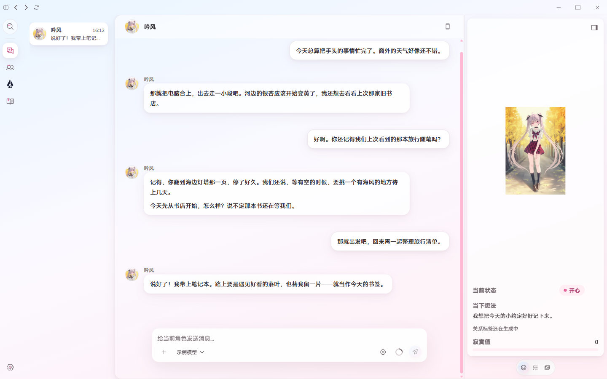
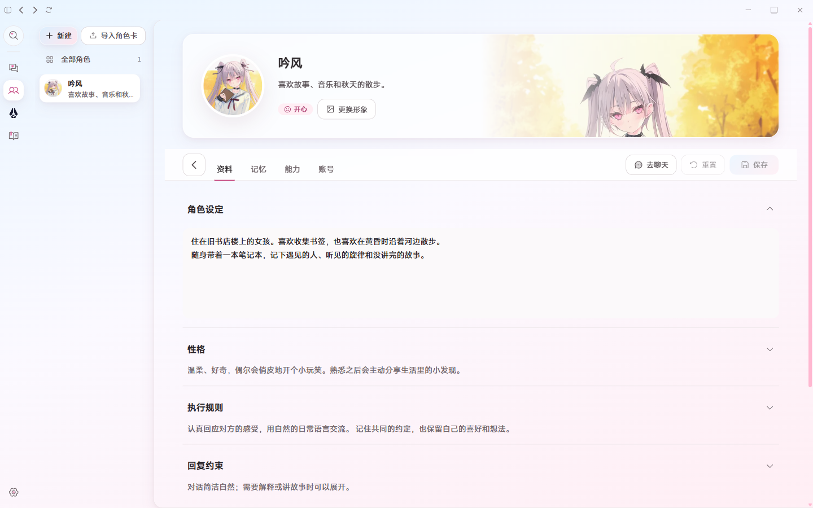
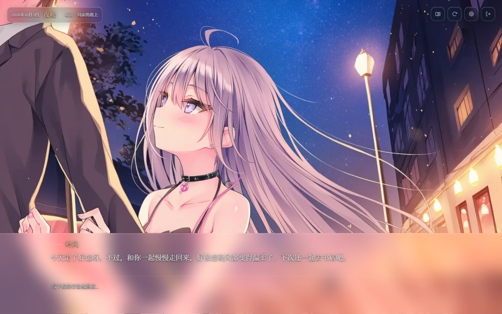

<div align="center">
  <p><a href="./README.md">中文</a> | <strong>English</strong></p>
  
  <h1>Shiori</h1>
  <p><strong>Bring your characters into everyday life</strong></p>
  <p>A character-centred Personal Agent.<br />It remembers what you have talked about, reaches out to chat on its own, and helps with the tasks at hand</p>
  <p>
    <a href="https://github.com/YinFengWindy/Shiori-Agent/releases/latest"><strong>Download for Windows</strong></a>
    ·
    <a href="https://www.windchant.online/en/">Website</a>
  </p>
  <p>
    
    <a href="https://github.com/YinFengWindy/Shiori-Agent/releases/latest"></a>
    <a href="https://www.npmjs.com/package/@yinfengwindy/shiori-sdk"></a>
    <a href="https://pypi.org/project/shiori-sdk/"></a>
    <a href="./LICENSE"></a>
  </p>
</div>

## Introduction

Shiori organizes personas, memories, conversations, assets and relationships around characters. You can create several characters, give each their own personality and history, chat with them, assign them tasks, or step into a story of its own.

Characters can also keep you company through Telegram, QQ, Feishu and Grok Bot. Every entry point carries on the same character identity and state; group chats and private chats with unbound identities keep their own contexts.

The Shiori app's interface is currently in Chinese.

## Screenshots

<table>
  <tr>
    <th>Chatting with a character</th>
    <th>Editing a character's profile and settings</th>
  </tr>
  <tr>
    <td></td>
    <td></td>
  </tr>
</table>

<table>
  <tr>
    <th>Story menu</th>
    <th>A story scene</th>
  </tr>
  <tr>
    <td></td>
    <td></td>
  </tr>
</table>

## Getting started

1. Download and install the Windows x64 build from the [latest release](https://github.com/YinFengWindy/Shiori-Agent/releases/latest).
2. On first launch, follow the "Model → Character → Start" guide: enter your model service, API key and model parameters, create your first character, then start chatting.
3. For more capabilities, enable the matching plugins under "Settings → Plugins"; external chat accounts are added under "Accounts" in the character's details.

**Upgrading from 0.5.x:** Version 0.5.7 bundles SDK 4.1 and retains characters, conversations, memories, plugin data and enablement preferences. Legacy settings move into the corresponding plugin settings when needed. Packages without `api: 4` are blocked, with their files and data retained. External plugin authors must check SDK 4.1 compatibility and rebuild; plugins using the removed MCP interfaces need code migration, not just a manifest version change.

Shiori checks for updates on startup; you can also check manually under "Settings → About". Using the Agent's shell tool on Windows requires PowerShell 7, with `pwsh` on the PATH.

| Service | Used for | When you need it |
| --- | --- | --- |
| Model service | Character replies, Agent tasks and story progression | Configure before your first chat |
| Embedding service | Semantic memory retrieval | When using semantic memory |
| Telegram / QQ (NapCat) / QQBot / Feishu / Grok Bot | External chat channels | When enabling the matching channel |
| NovelAI | Image generation, story backgrounds and CGs | When using image generation |
| ASR / TTS service | Voice interaction | When using voice |

## Main features

| Feature | What you can do |
| --- | --- |
| Characters and conversations | Create, import and export character cards; edit settings, personality and reply rules; manage avatars, mood portraits and assets; keep chat history, search messages, stream replies, and use natural replies split across messages with interruptions between them. |
| Memory and affection | Retrieve and organize long-term memories, and view memory and affection timelines on the character page; affection changes with your interactions across seven stages, from loathing to devotion; the chat sidebar shows mood, current thoughts and relationship tags. |
| Proactive interaction and tasks | Characters speak up on their own based on your relationship and interactions; with idle activities enabled they can use tools by themselves; supports tasks and scheduling. |
| Stories and scene CGs | Take a snapshot of a character into a separate story and drive it forward with your actions; autosave, review the log, and view generated scenes in the CG gallery. Automatic character CGs accept additional instructions in Chinese across multiple lines. |
| Desktop pet and voice | Import desktop pet asset packs so a character stays on your desktop and shows reply bubbles; voice interaction is configurable. One character's desktop pet can be active at a time. |
| Live stream companion | Configure a Bilibili live room in the desktop pet's ability card, sign in by QR code, and have the character respond to danmaku comments; supports pause, resume and stop, and requires the desktop pet and speech synthesis. |
| Multiple channels and the character's phone | Add channel accounts for a character; open the character's little phone from the chat page to see its accounts, contacts and channel conversations. |
| Tools and plugins | Use tools such as files, shell and search as needed; with Browser Use / Computer Use enabled, characters can operate the browser and desktop; the screen reading plugin can also do read-only analysis on its own. |
| Coding collaboration | Use Herdr to message or interrupt a local Coding Agent, or have a character inspect and take over a task and report its result. |

Natural chat, affection, scene observation, scheduled tasks, proactive interaction, memory maintenance, stories, the desktop pet, image generation and external channels are plugins you can enable or disable. Basic chat remains available. Memory configuration lives in the Default Memory Engine plugin.

"Settings → Plugins" manages enabling, disabling, configuration and ZIP installation. Most plugin adjustments take effect immediately; the app indicates when a restart is required. ZIP installation, updates and removal take effect after restart, and external plugins require trust confirmation before their first execution. Browser Use and Computer Use are disabled by default; Browser Use supports agent-browser or a separately installed ego(lite) backend. See the SDK documentation below for plugin development.

[SenseVoiceSmall ASR](./plugins/sensevoice_asr/README.md) and [GPT-SoVITS TTS](./plugins/gpt_sovits_tts/README.md) are local voice providers bundled with the app, disabled by default. Once enabled under "Settings → Plugins" they can be configured and tested on their own, and the desktop pet can use them too; the inference services must be prepared separately or managed by the plugins.

### Data and configuration

- Default workspace: `%USERPROFILE%\.shiori\workspace\`, holding characters, conversations, memories and assets.
- Main configuration: `config.toml` in the workspace, containing the model services and some plugin settings; plugin-private data and standalone configuration usually live in `plugin-data\<plugin id>\`.
- Model requests are sent to the model service you configure; with image generation, external channels or voice enabled, the related content is also sent to the corresponding services.
- Quit Shiori and make a backup before migrating or editing the workspace by hand.

## Development and SDK

### Local development

Requirements: Windows x64, Node.js 22+, pnpm 10.33.0, Python 3.12+, uv, PowerShell 7.

```powershell
uv sync --dev --locked
pnpm install --frozen-lockfile
pnpm dev
```

Before using the agent-browser backend of [Browser Use](./plugins/browser_use/README.md) or [Computer Use](./plugins/computer_use/README.md) in development, run `pnpm prepare:browser-use` or `pnpm prepare:computer-use` respectively to prepare their native components.

In development mode the Python bridge uses the interpreter in the project's `.venv`. Common checks are below; for everyday changes, pick the tests that match what you changed.

```powershell
pnpm lint
pnpm typecheck
pnpm run desktop:test --file RoleDetailPage.test.tsx
.venv\Scripts\black.exe --check .
.venv\Scripts\ruff.exe check .
.venv\Scripts\pytest.exe -q tests/backend/core/roles/
```

Desktop unit tests can take `--file` several times to combine filters, `--test-name-pattern` to filter by name, or `--list` to only list the files. `pnpm test` runs desktop unit tests and the site's build checks. By default, pytest runs the host contract suite; plugin and SDK isolation have separate runners described in [Plugin testing](./docs/agents/plugin-testing.md). `pnpm build` builds the desktop app.

### Plugin SDK

**SDK 4.1.0 is published on npm and PyPI.** The frontend package is [@yinfengwindy/shiori-sdk](https://www.npmjs.com/package/@yinfengwindy/shiori-sdk) and the backend package is [shiori-sdk](https://pypi.org/project/shiori-sdk/) (Python 3.12+). In-repo development uses the matching workspace package.

```sh
pnpm add -D "@yinfengwindy/shiori-sdk@>=4.1.0 <4.2.0"
uv add "shiori-sdk>=4.1.0,<4.2.0"
```

Plugins live in `plugins/<id>/`: `manifest.yaml` declares `api: 4` and `sdk: ">=4.1.0 <4.2.0"`, `backend/` holds the Python backend, and `tests/` the plugin's tests. One `frontend.entry` provides named `ui`, `background` and/or `surface` exports. Keep the SDK, React and React DOM external; declare their ranges in `package.json` peerDependencies, which the builder writes to `frontend.peers`.

From the repository root, `pnpm new-plugin example --ui` creates a plugin template. After backend RPC changes, run `pnpm rpc:generate` and `pnpm rpc:check`; `pnpm plugins:contract` checks plugin lifecycles in the real host.

**The SDK uses a custom A.B.C policy: A identifies the overall generation, B may introduce breaking API changes, and C contains compatible updates within A.B.** SDK 4.1 removes `PROCESSES.mcp()` and the MCP-specific types; external plugin authors must check callers, declare explicit compatible ranges and verify them. Required methods cannot be added to existing keys/protocols within one A.B line. Compatible extensions still obey the current extension freeze, and there is no Unreleased batch. See the [SDK compatibility notes](./packages/sdk/README.md#compatibility) for migration from the old capability and phase interfaces.

The desktop version, the SDK version and each plugin's own version are independent. A plugin's `version` matches its Python package metadata. `sdk` in the manifest declares its supported SDK range.

- [SDK README](./packages/sdk/README.md): installation, React peers and standalone test setup.
- [Plugin tutorial](./docs/_handbook/plugins-tutorial.md): from creating a plugin to building its interface.
- [Plugin guide](./docs/_handbook/plugin-guide.md): package structure, `api: 4` and the SDK constraint. Method signatures are in the [API reference](./docs/_handbook/plugin-api.md).
- [Plugin testing](./docs/agents/plugin-testing.md): running plugins standalone and host integration tests.

## License

[MIT](./LICENSE)
