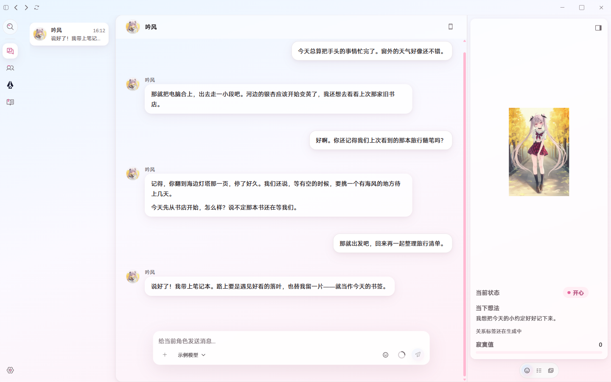
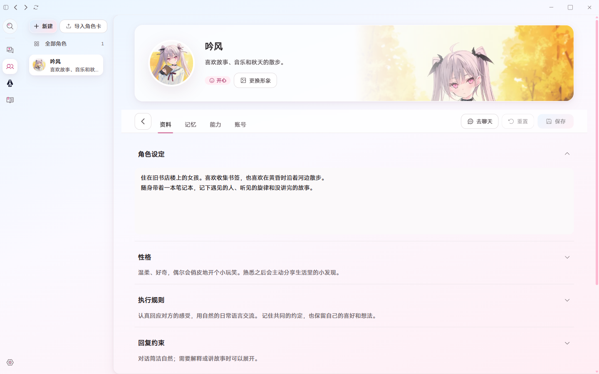
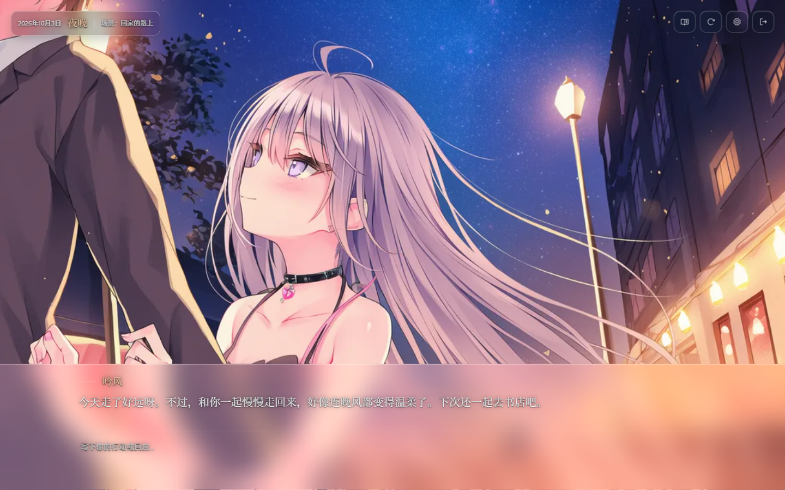

<div align="center">
  <p><a href="./README.md">中文</a> | <strong>English</strong></p>
  
  <h1>Shiori</h1>
  <p><strong>Bring your characters into everyday life</strong></p>
  <p>A character-centred Personal Agent.<br />It remembers what you have talked about, reaches out to chat on its own, and helps with the tasks at hand</p>
  <p>
    <a href="https://github.com/YinFengWindy/Shiori-Agent/releases/latest"><strong>Download for Windows</strong></a>
    ·
    <a href="https://www.windchant.online/en/">Website</a>
  </p>
  <p>
    
    <a href="https://github.com/YinFengWindy/Shiori-Agent/releases/latest"></a>
    <a href="https://www.npmjs.com/package/@yinfengwindy/shiori-sdk"></a>
    <a href="https://pypi.org/project/shiori-sdk/"></a>
    <a href="./LICENSE"></a>
  </p>
</div>

## Introduction

Shiori organizes personas, memories, conversations, assets and relationships around characters. You can create several characters, give each their own personality and history, chat with them, assign them tasks, or step into a story of its own.

Characters can also keep you company through Telegram, QQ and Feishu. Every entry point carries on the same character identity and state; group chats and private chats with unbound identities keep their own contexts.

The Shiori app's interface is currently in Chinese.

## Screenshots

<table>
  <tr>
    <th>Chatting with a character</th>
    <th>Editing a character's profile and settings</th>
  </tr>
  <tr>
    <td></td>
    <td></td>
  </tr>
</table>

<table>
  <tr>
    <th>Story menu</th>
    <th>A story scene</th>
  </tr>
  <tr>
    <td></td>
    <td></td>
  </tr>
</table>

## Getting started

1. Download and install the Windows x64 build from the [latest release](https://github.com/YinFengWindy/Shiori-Agent/releases/latest).
2. On first launch, follow the "Model → Character → Start" guide: enter your model service, API key and model parameters, create your first character, then start chatting.
3. For more capabilities, enable the matching plugins under "Settings → Plugins"; external chat accounts are added under "Accounts" in the character's details.

Shiori checks for updates on startup; you can also check manually under "Settings → About". Using the Agent's shell tool on Windows requires PowerShell 7, with `pwsh` on the PATH.

| Service | Used for | When you need it |
| --- | --- | --- |
| Model service | Character replies, Agent tasks and story progression | Configure before your first chat |
| Embedding service | Semantic memory retrieval | When using semantic memory |
| Telegram / QQ (NapCat) / QQBot / Feishu | External chat channels | When enabling the matching channel |
| NovelAI | Image generation, story backgrounds and CGs | When using image generation |
| ASR / TTS service | Voice interaction | When using voice |

## Main features

| Feature | What you can do |
| --- | --- |
| Characters and conversations | Create, import and export character cards; edit settings, personality and reply rules; manage avatars, mood portraits and assets; keep chat history, search messages, and turn on streaming replies. |
| Memory and affection | Retrieve and organize long-term memories, and view memory and affection timelines on the character page; affection changes with your interactions across seven stages, from loathing to devotion; the chat sidebar shows mood, current thoughts and relationship tags. |
| Proactive interaction and tasks | Characters speak up on their own based on your relationship and interactions; with idle activities enabled they can use tools by themselves; supports tasks and scheduling. |
| Story mode | Take a snapshot of a character into a separate story and drive it forward with your actions; autosave, review the log, and view generated scenes in the CG gallery. |
| Desktop pet and voice | Import desktop pet asset packs so a character stays on your desktop and shows reply bubbles; voice interaction is configurable. One character's desktop pet can be active at a time. |
| Live stream companion | Configure a Bilibili live room in the desktop pet's ability card, sign in by QR code, and have the character respond to danmaku comments; supports pause, resume and stop, and requires the desktop pet and speech synthesis. |
| Multiple channels and the character's phone | Add channel accounts for a character; open the character's little phone from the chat page to see its accounts, contacts and channel conversations. |
| Tools and plugins | Use tools such as files, shell and search as needed; with Browser Use / Computer Use enabled, characters can operate the browser and desktop; the screen reading plugin can also do read-only analysis on its own. |

Stories, the desktop pet, image generation and external channels are all provided as plugins. "Settings → Plugins" manages enabling, disabling, configuration and ZIP installation; installing, updating and uninstalling from ZIP takes effect after a restart, and a third-party plugin asks for trust confirmation the first time it loads. Browser Use and Computer Use are disabled by default. See the SDK documentation below for plugin development.

[SenseVoiceSmall ASR](./plugins/sensevoice_asr/README.md) and [GPT-SoVITS TTS](./plugins/gpt_sovits_tts/README.md) are local voice providers bundled with the app, disabled by default. Once enabled under "Settings → Plugins" they can be configured and tested on their own, and the desktop pet can use them too; the inference services must be prepared separately or managed by the plugins.

### Data and configuration

- Default workspace: `%USERPROFILE%\.shiori\workspace\`, holding characters, conversations, memories and assets.
- Main configuration: `config.toml` in the workspace, containing the model services and some plugin settings; plugin-private data and standalone configuration usually live in `plugin-data\<plugin id>\`.
- Model requests are sent to the model service you configure; with image generation, external channels or voice enabled, the related content is also sent to the corresponding services.
- Quit Shiori and make a backup before migrating or editing the workspace by hand.

## Development and SDK

### Local development

Requirements: Windows x64, Node.js 22+, pnpm 10.33.0, Python 3.12+, PowerShell 7.

```powershell
py -3.12 -m venv .venv
.venv\Scripts\python.exe -m pip install -r apps/backend/requirements/development.txt
pnpm install
pnpm dev
```

Before using [Browser Use](./plugins/browser_use/README.md) / [Computer Use](./plugins/computer_use/README.md) in development, run `pnpm prepare:browser-use` / `pnpm prepare:computer-use` respectively to prepare their native components.

In development mode the Python bridge uses the interpreter in the project's `.venv`. Common checks are below; for everyday changes, pick the tests that match what you changed.

```powershell
pnpm lint
pnpm typecheck
pnpm test --file RoleDetailPage.test.tsx
.venv\Scripts\black.exe --check .
.venv\Scripts\ruff.exe check .
.venv\Scripts\pytest.exe -q tests/backend/core/roles/
```

Desktop unit tests can take `--file` several times to combine filters, `--test-name-pattern` to filter by name, or `--list` to only list the files. For a full run, `pnpm test` runs the host and plugin unit tests, `.venv\Scripts\pytest.exe -q` collects the backend, plugin and SDK tests per the repository configuration, and `pnpm build` builds the desktop app.

### Plugin SDK

The SDK and Runtime API in the current source are both at **3.1.1**; earlier unreleased contract changes have been merged into this batch. **3.1.1** is published on both npm and PyPI, so this batch's interfaces can be installed and used directly. The frontend package is [@yinfengwindy/shiori-sdk](https://www.npmjs.com/package/@yinfengwindy/shiori-sdk) and the backend package is [shiori-sdk](https://pypi.org/project/shiori-sdk/) (Python 3.12+). These commands install the current public version:

```sh
pnpm add -D "@yinfengwindy/shiori-sdk@^3.1.1"
uv add "shiori-sdk>=3.1.1,<4"
```

Plugins live in `plugins/<id>/`: `manifest.yaml` declares capabilities and compatibility, `backend/` holds the Python backend, `ui/` an optional React interface, and `tests/` the plugin's tests. Frontend builds must keep the SDK, React and React DOM external; Shiori provides them at runtime. Plugins that only use the earlier compatible interfaces can keep `runtime_api: ">=3.1.0 <4.0.0"`; plugins that use interfaces added in this batch declare `">=3.1.1 <4.0.0"` and set their Python SDK dependency's lower bound to `3.1.1` as well.

**Compatibility note: 3.1.1 contains breaking changes.** The published `SurfaceHandle.voice` interface has been removed, and `closeness` in relationship snapshots has been replaced by affection; affected plugins must migrate, and a passing version range does not mean the old interfaces still work. See the [SDK compatibility notes](./packages/sdk/README.md#compatibility). From now on, ordinary contract PRs only accumulate unreleased records; versions are settled together when the SDK or a desktop release with new contracts is published.

The desktop version, the SDK / Runtime API version and each plugin's own version are independent. The 20 existing plugins in the repository (including those with updated compatibility declarations) are at **0.1.1**, and the new SenseVoice ASR / GPT-SoVITS TTS plugins are at **0.2.0**; a plugin's `version` matches its Python package metadata, and `runtime_api` separately declares the host interfaces it needs.

- [SDK README](./packages/sdk/README.md): installation, React peers and standalone test setup.
- [Plugin tutorial](./docs/_handbook/plugins-tutorial.md): from creating a plugin to building its interface.
- [Runtime contract](./docs/_handbook/plugin-runtime-contract.md): package structure, capability boundaries and version compatibility.
- [Plugin testing](./docs/agents/plugin-testing.md): running plugins standalone and host integration tests.

## License

[MIT](./LICENSE)
