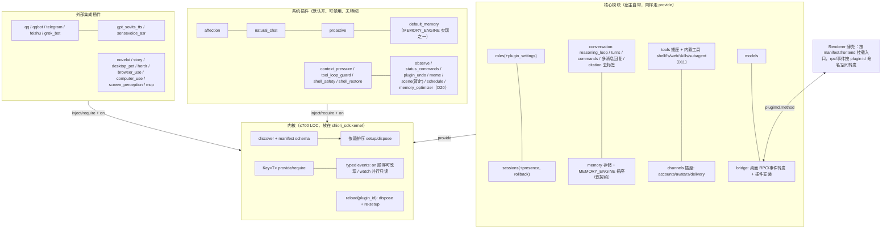

# Shiori 插件系统四层重构方案（盘点 + 分阶段计划 + Harness）

> 基线：YinFengWindy/Shiori-Agent `main` @ `976f920`。
> 本文只做规划，不含实现代码。2026-10-22 更新：已记入 27 项决策（D1–D27，见「决策记录」；含 PR #897 两轮审查回应），相关盘点、阶段和 LOC 估算同步调整。审查原文见 [`2026-10-22-plugin-system-review-report.md`](2026-10-22-plugin-system-review-report.md)。LOC 统计用 `wc -l`（含注释和空行，不含测试），数字是量级参考。

## 0. 四层规则

| 层 | 定义 | 可禁用 | 依赖方向 |
|---|---|---|---|
| **内核 Kernel** | 只负责加载插件：发现、manifest 校验、服务注册（provide/require）、typed 事件（`on` 顺序传递可改写 + `watch` 并行只读）、按依赖顺序 setup、可 dispose 的注册、单插件热重载、start/stop。不懂任何业务，本身不是插件，目标见 §8.8（≤700 LOC） | — | 不 import 任何业务 |
| **核心模块 Core** | 没有它就聊不了天的部分，随宿主发布，不可删、不安装卸载，但同样用 `provide` 注册服务。插座类接口（tools/channels/commands…）的契约类型由提供它的模块持有 | 否 | 可 import 内核和 SDK，禁止 import 插件 |
| **系统插件 System** | 官方内置、默认开启、可以禁用。和第三方插件用同一套 API，没有任何特权 | 是 | 只能 import SDK 和已声明依赖的插件 |
| **外部集成插件 External** | 渠道、TTS/ASR、工具、MCP 等外部集成 | 是 | 同上 |

**判定规则：把它拔掉，app 还能正常聊天吗？** 不能 → 核心模块；能 → 插件。系统插件和外部插件的区别只在于"是不是官方默认开启"。"伴侣本体"是产品概念，横跨核心和若干系统插件，不单独成层。

## 决策记录（2026-10-22）

| # | 决策 | 落地方式 | 影响 |
|---|---|---|---|
| D1 | **记忆引擎接口是核心"插座"；default_memory 只是这个插座的一个可替换"实现"插件** | **插座（核心）**：核心只拥有 `MemoryEngine` 契约（Protocol、请求/结果类型、引用标记格式）和 `MEMORY_ENGINE` Key，放在 SDK 的核心契约里（沿用现有 `shiori_sdk/memory/engine.py`），核心里没有任何记忆引擎实现。**实现（插件）**：default_memory 是系统插件，在 `setup` 里 `provide(MEMORY_ENGINE, engine)`，可以被其他实现插件替换。记忆工具（memorize/recall/forget，约 418 行）属于实现，随 default_memory 走。核心 memory 模块只保留 markdown 记忆存储（role/member profile、group environment），它不是引擎 | 插件目录不再因记忆引擎产生核心项（最终计数见 D9：核心 1、系统 9、外部 14）。删掉 bootstrap 里专门加载记忆引擎的代码（`memory_plugins.py`/`memory.py`/`runtime/memory.py`/`memory_capabilities.py`，约 280 行），改走普通插件加载 |
| D1′ | **没有实现插件时（例如禁用 default_memory）选"可选插座"，不做 no-op provider，也不强制至少一个 provider**（更简单） | 消费方统一 `ctx.get(MEMORY_ENGINE)`，拿到 None 就不检索、不注册记忆工具，照常聊天。现有 `agent/retrieval/default_pipeline.py` 已经有 `engine is None → 空结果` 分支，等于零新增代码。设置页显示"记忆已关闭" | 不需要 NullMemoryEngine 类，也不需要启动时的 provider 数量校验。"拔掉还能聊"由 CI 的 core-only 冒烟测试守住 |
| D2 | **proactive 是可禁用的系统插件**，核心不依赖它 | proactive_v2、proactive_turn、drift_turn 整体搬进 `plugins/proactive`（P6b）。核心只提供 CONVERSATION/CHANNELS/ROLES 等服务，可选读 AFFECTION | **scheduler 不随 proactive 走**：proactive 相关代码都不 import `agent/scheduler`，scheduler 另有其他使用方（schedule 工具、桌面角色任务）。scheduler 做成独立系统插件 `schedule`（D17），proactive 只可选 inject 它 |
| D3 | **内核放在 SDK：`shiori_sdk.kernel`** | P1 直接在 SDK 里建内核，宿主 `agent/plugin_host` 改成薄的装配层（发现路径、核心 provide 列表、bridge 安装器）。测试和宿主跑同一份内核代码 | Harness：FakeContext = 真内核 + stub 服务，不再维护任何 ctx 镜像。P5 的 SDK 缩减随之变成"删镜像"，新增很少 |
| D4 | **外部 3.x 插件 zip 直接拒绝** | 安装和加载时，非 `api: 4` 的包报一条明确错误：「该插件为旧版插件 API（3.x），本版本不再支持，请安装插件作者发布的新版本」。没有迁移，也没有兼容层。内置 24 个插件全部在仓库内迁移 | 计划里删掉所有 3.x 兼容工作：runtime_api 范围解析、package_contract 兼容、manifest 迁移。versions.py、host_contract.py、data_migration.py 直接删除 |
| D4′ | **已发布 0.5.x 的用户数据保持兼容**（这一点不变） | `plugin_data/<id>/` 目录、kv.json 格式、插件配置值、启用状态键、`state/affection.json` 的路径和格式都不变，新插件直接读旧位置 | 只为这些数据保留读取路径，不写迁移脚本（格式本来就不变） |
| D5 | **desktop_pet 是外部插件**（不是系统插件） | 留在 `plugins/desktop_pet`，`category: integration`；前端仍是 frontend 单入口的试金石（ui + surface + background 三个具名导出） | 插件盘点：核心 1、系统 9、外部 14（含 D9） |
| D6 | **story 是外部插件** | story 硬依赖默认关闭的 novelai，这一点已接受：两者都是外部插件，用户启用 story 时，novelai 要一并启用（manifest 声明依赖，内核按依赖序 setup，缺依赖时 story 给出明确提示） | 不需要为 story 抽象出生图插座 |
| D7 | **scene 暂定为系统插件**（不进核心，倾向插件） | core/scene（808 行）以后搬成 `plugins/scene` 并 provide `SCENE`；消费方 novelai、desktop_pet 用 `get(SCENE)`。搬迁放进 P6a（P9 已取消，见 D11） | 暂定；如果迁移时发现回合主链离不开它，再回到核心 |
| D8 | **natural_chat：核心保留通用的多消息回复能力，插件只提供提示词和策略** | 核心 conversation 持有 finish_reply 多消息协议、`natural_reply.py` 的消息校验和 deliver_sequence 投递（不论是否启用 natural_chat 都在）。natural_chat 系统插件只通过 `PromptRendering` 注入提示词，通过 `ReasoningFinished` 等事件调整拆分、节奏等策略，不自带投递代码 | 禁用 natural_chat 后，回复退回单条或由模型自行决定，照常聊天；`runtime_config.natural_chat_enabled` 继续作为开关读取（0.5.x 兼容） |
| D9 | **citation 并入核心**（拔掉会让协议标签漏进回复） | `plugins/citation`（172 行）搬进核心 conversation 的回复管线：解析和去除引用标签、记录本轮用到的记忆 ID。标记格式以 `MEMORY_ENGINE` 插座契约为准，不依赖 default_memory 或任何具体实现；插座为空时照样去除标签 | 插件目录计数：**核心 1（citation）、系统 9、外部 14**。meme → citation 的依赖随之解决：meme 改为依赖核心服务/事件（`CONVERSATION` / `ReasoningFinished`），不再依赖插件 |
| D10 | **plugin_undo 保留为系统插件；两个插座各加一个回滚方法** | `SESSIONS.rollback_last_turn(session_key) -> RollbackResult`（核心 sessions 实现）；`MemoryEngine.rollback_turn(turn_id, message_ids)`（写进 `MEMORY_ENGINE` 插座契约，由 default_memory 等实现；2026-10-27 维护者确认加 `message_ids`：会话侧预读整轮消息 id，记忆按整轮回滚）。plugin_undo `inject: [sessions, commands]`、`optional_inject: [memory_engine]`；插座为空时只回滚会话 | P3 增约 80 行（两个方法 + 契约测试）。插座契约变更随 api 4 一起发布，不单独升版本 |
| D11 | **内置工具留核心（显式例外）+ 链后固定安全校验（R1）** | 工具仍留核心。**安全不变量**：核心内置**最小** shell 拦截；`shell_safety` 只叠加更严规则。最小拦截与 citation 去标签**不是** `on` 链上可被改写的 handler，而是 **`ToolCalling` / `ReasoningFinished` 链跑完之后的固定校验步骤**——插件改写危险参数或再插入协议标签仍会被拦下（契约测守住）。禁用 shell_safety 不裸奔 | P9 取消；§8.1 同步 |
| D12 | **renderer 的 voice、affection UI 搬进各自插件的前端** | `renderer/src/voice`（321 行）：录音控制进 sensevoice_asr 的 frontend，播放控制进 gpt_sovits_tts 的 frontend；两边共用的少量音频工具（预计不到 60 行）放进 TS SDK。`renderer/src/affection`（792 行）和散落的好感度 UI 进 `plugins/affection/ui`。插件挂在 renderer 已有的具名插槽上；缺插槽时由 renderer 新增一个具名插槽，不新增 kind | affection UI 在 P6a 随插件搬走；voice 在 P7。renderer 里不再有任何插件专属 UI |
| D13 | **拆分 diagnostics（回应 PR #897 / S4）** | **(a) 失败状态契约保留**：`PluginDiagnostic` / `PackageContractError` / `RendererActivationError`（现 `agent/plugin_host/diagnostics.py`）放在 **`shiori_sdk.kernel`（或 SDK 契约包）**，不作 bridge 私有类型（否则内核事件载荷要 import bridge）；设置页 BLOCKED 列表依赖它；与 observe 是否启用无关。**(b) 进程崩溃钩子改为核心服务**：新增核心 Key `CRASH_REPORTING`（仲裁 `sys.excepthook` / `threading.excepthook` / loop handler，取代 `shiori_sdk.diagnostics.install_global_hooks` 的宿主特权面）；observe **只** `inject: [crash_reporting]` 注册 collector，不再直接改写全局钩子。**(c) 删除「diagnostics capability = 遥测」的旧叙事**：内核只保留 `ctx.log` + `PluginStarted`/`PluginFailed`/`PluginStopped`（载荷可带 `PluginDiagnostic`）；遥测由 observe `watch` 事件。 | 不再整段删除 diagnostics；失败契约 ≠ 遥测 ≠ 崩溃钩子。P3/Harness 相应更新 |
| D14 | **保留热重载；渠道插件由内核判定为不可代内重载（R8 / T1，2026-10-22 维护者确认）** | `supports_hot_unload` 默认 `true`。**声明了 `contributes.channels`（D18）的插件由内核一律视为不可代内重载**，不在 manifest 里逐个手写：现网 `reload.py:101–109` 对用到 channels 的插件已拒绝代内重载，覆盖 qq、qqbot、telegram、feishu、grok_bot 五个。这些插件启用、禁用、重载都提示「需重启」，维护者已接受这个体验。TTS/ASR（`gpt_sovits_tts` / `sensevoice_asr`）保持默认可热重载，靠进程资源清理。其他插件只有**证实无法卸载**的原生扩展才手标 `false`。**规则**：reload 闭包里只要有不可重载的插件，**整体拒绝**，诊断「需重启」。文档写进 `AGENTS.md` 和插件编写文档/schema。Harness：可重载的插件测「无残留 + 顺序与冷启动一致」，不可重载的插件测「需重启」路径 | 回应 R8 / T1；装配层仍负责 re-import / on_drain |
| D15 | **事件新增并行只读监听 `ctx.watch`** | `on` = 顺序传递，可改写；`watch` = 并行只读，**fire-and-forget**：顺序链跑完后，内核把最终事件（frozen dataclass）交给每个 watcher，作为该插件 scope 上的任务运行；`emit` 不等待，watcher 抛错只记日志，不影响主链，插件 dispose 时一并取消 | 选 fire-and-forget 而不是 awaited-gather：observe 这类监听不应该拖慢回合。测试里用 `shiori_sdk.testing` 的 `await harness.idle()` 等 watcher 跑完（只在测试 harness 里，不进 ctx）。内核约增 25 行 |
| D16 | **保留 zip trust_store** | `agent/plugin_host/trust_store.py`（88 行）和 `desktop_bridge/runtime/plugin_trust.py`（214 行）保留，P8 搬进 bridge 安装器但不删除。安装 v4 外部 zip 时仍弹信任提示；3.x zip 在信任提示之前就被拒绝（D4） | P8 少删约 0.3k |
| D17 | **scheduler 做成独立系统插件 `schedule`**（不进核心，也不并入 proactive；以本条为准） | `plugins/schedule` 包含：scheduler 服务（`agent/scheduler.py` 733 + `scheduler_cron` 137，provide `SCHEDULER`）、schedule 工具（`agent/tools/schedule.py` 267 + `bootstrap/toolsets/schedule.py`，由插件注册到核心 `TOOLS`）、桌面角色定时任务（`desktop_bridge/schedule_role_task_service.py` 96 改成插件 rpc，前端 `RoleTaskScheduleFields` 等搬进插件 frontend）。定时任务 JSON（JobStore）路径和格式不变 | 理由：schedule 是用户或角色事先约好的定时触发，proactive 是角色自己决定什么时候找你，触发方不同。两者互不依赖：proactive `optional_inject: [schedule]`，没有也能工作；禁用 proactive 不影响 schedule；禁用 schedule 时 schedule 工具不注册、角色任务里的定时任务区块不显示，proactive 照常。角色任务面板本身还列出 subagent 和记忆任务，所以面板外壳留在核心 renderer，schedule 通过前端具名插槽 `roleTasks` 挂入自己的区块（⚑ 新增一个 UI 插槽，不需要后端插座；D21 已确认）。新增阶段 P6s |
| D18 | **渠道静态声明保留在 manifest：`contributes.channels`** | manifest v4 保留 `contributes.channels`（只放静态元数据：id、名称、图标、账号表单 schema）。bridge 不加载插件就能读到，账号页在插件禁用时也能列出渠道；运行时的连接、收发仍走 `CHANNELS` 服务 | manifest schema 增加这一段；契约测试检查声明的渠道在运行时都注册了 |
| D19 | **proactive 拆分方案已确认**（第 7 节） | 按第 7 节执行：核心新增/通用化 5 个 API——`SESSIONS.presence`、`CONVERSATION.deliver_initiated_reply`、`InitiatedMessageCommitted` 事件、`ROLES.plugin_settings`、renderer `roleSettings` 插槽；proactive_gates 删除，gate 变成插件内部列表 | P6b 按 7.5 的 6 个 PR 实施 |
| D20 | **memory_optimizer → 系统插件（推翻先前「进核心」）** | **证据（2026-10-22 重查）**：`proactive_v2/memory_optimizer.py`（621 行）只后台重写 `MEMORY.md` / `SELF.md`；由 `bootstrap/proactive.py::build_memory_optimizer_task` → `bootstrap/runtime/background.py` 启动；`memory_optimizer_enabled=false` 时直接跳过（`config.py` / `config_models.py`）；桌面侧仅 `desktop_bridge/role_task_service.py` 可手动触发。**回合路径零引用**：`agent/turns`、`lifecycle`、`retrieval`、`conversation` 均不 import。拔掉/禁用后照常聊天 → 按分层规则做成**系统插件** `memory_optimizer`（可禁用，默认开），provide 可选服务供角色任务面板挂「立即整理」；**不**进核心 memory。 | 回应 PR #897 / M6；覆盖先前 D20「移进核心」 |
| D21 | **角色任务面板外壳留在核心，schedule 通过 `roleTasks` 插槽挂入** | 核心 renderer 保留面板外壳，继续列出 subagent 和记忆任务；schedule 插件前端挂入定时任务区块 | 只新增一个前端插槽，不需要后端插座；在 P6s 完成 |
| D22 | **版本策略（修订，回应 R3）** | **大版本 = 破坏性**。manifest `api: 4` + sdk 最低约束（peer）。SDK 独立 semver；**废除** Unreleased/sync 批次。同大版本内：**禁止**给已有 Key/Protocol **新增方法**；新能力一律以**新 Key**（或新 Event）出现。缺 Key → setup 失败 + `PluginDiagnostic`。D10/D19 的新方法必须在进 4.0 前并入基线契约，4.0 之后只能开新 Key。现行 `runtime_api` 删除 | P5；改 AGENTS.md |
| D23 | **发布边界** | 桌面发版**仅在 P1–P8 全部完成后**随 SDK 4.0 一起发。P1–P8 期间**不从 main 发桌面版**（「不发没事」，见 D26）。已装 3.x/`api:2` → 启动 BLOCKED、不迁移、保留文件配置。不要求可降级。0.5.x 用户数据正向兼容仍按 D4′ | P4/P8；D13 Diagnostic |
| D24 | **`conflicts` / `replaces`（修订，回应 R5）** | `replaces: [other_id]` = **被替换插件整体不加载**（强于只盖 Key；UI 显示「已被 X 替换」）。`conflicts: [other_id]` = 不可同时启用。未声明关系的双 provide 同一 Key → **双方都标 BLOCKED**，诊断互相点名，其他插件照常启动；插件与核心 provide 同一个 Key 时整个启动失败（2026-10-22 维护者在 P1 实现时确认） | 避免 default_memory 被替后仍注册工具/handler |
| D25 | **热重载排空：`ctx.on_drain`，不用活代理（R2 / T3）** | `require`/`get` 返回原始对象，删掉 seal 的说法。reload 时先排空闭包里的每个插件，再 dispose，再 re-setup。**默认排空（不注册 `on_drain` 也生效）**：内核只等该插件正在执行的 `on`/`watch` handler 结束；`spawn` 出去的任务不参与排空，dispose 时按 §8.4 的顺序直接取消（2026-10-22 维护者在 P1 实现时确认：常驻循环永远不会结束，等它会让每次 reload 都超时）。注册了 **`ctx.on_drain`** 的插件，再额外执行自己的排空逻辑。总超时 60 秒，超时则中止这次 reload、保留旧实例并产出诊断。**核心不得长期持有** provider 实例，每次使用都重新 `get`。契约测试：provider 带代际 id，重载后下一次调用必须拿到新代际；另测「未注册 `on_drain`」的默认排空路径 | §8.2；P1 |
| D26 | **重构期不发桌面版；停用自动发版（R4）** | P1–P8 期间不发桌面版。仓库的自动桌面发版已停用：`.github/workflows/windows-release.yml` 的 `schedule` cron 随 PR #897 注释掉，**必须在任何 P1 代码 PR 之前合入 main**（GitHub 定时任务只认默认分支）。`apps/desktop/scripts/daily-release.mjs` 留在仓库，恢复日程后发布流程仍走它。`v*` tag 和 `workflow_dispatch` 保留，但重构期不用。**不设 `release/0.5.x` 热修分支**：维护者确认目前没有需要热修的 bug，接受重构期 0.5.x 不出修复版的风险 | 「不发没事」 |
| D27 | **配置外迁：只迁缺失的键，迁完从 `config.toml` 删掉（R7 / T2，2026-10-22 维护者确认）** | 从宿主 `config.toml` 搬进插件的配置，在启动时迁入插件配置存储。规则：**只有插件配置里还没有这个键时才迁入**；迁入成功后，**从 `config.toml` 删掉已迁移的键**，插件此后只读插件配置，避免 toml 旧值覆盖用户在设置页的修改，也避免用户改了旧键却静默不生效。迁移失败时不删 toml 键，并产出诊断；重复执行是安全的（插件配置里已有的键不覆盖、toml 里已经没有的键不处理）。**不**给内置插件开读取 toml 命名段的特权。迁移清单（以 976f920 源码为准）：proactive 配置段、`memory_optimizer_enabled`、`scene_observation_enabled`。`natural_chat_enabled` 存在角色 JSON 的 `runtime_config` 里，不在本条范围。与 D4′ 的关系：只改配置键的存放位置；`plugin_data/`、kv、启用状态等 0.5.x 路径和格式不变。memory_optimizer 要「插件启用」和 `memory_optimizer_enabled` 同时为真才运行（真值表见 §8.6） | P6 各外迁 PR 填写「现位置 → 新位置」表 |

**2026-10-27（P3-8，维护者确认）**：`session_key()` 与 `top_frame()` 放在 `CRASH_REPORTING` 协议上，不另开 Key。二者原来在 `HostDiagnostics` / `shiori_sdk.diagnostics`，observe 的 collector 在 `inject: [crash_reporting]` 之后仍要用它们给崩溃标注会话和栈帧。该协议尚未进入 4.0 基线，按 D22「新方法必须在进 4.0 前并入基线」并入现有协议。capability `diagnostics` 删除（**breaking**）；`PluginDiagnostic` / `PackageContractError` / `RendererActivationError` 仍留在 `shiori_sdk.kernel`。`TurnCommitted` 在 P3 继续只走领域总线。`ContextBudgetObserved` 与 `MemoryWritten` 由发布方先取一份只读副本，先在总线上发出原事件，再向内核 `emit` 副本（内核 emit 抛错时总线那份不丢）；observe 对这两类用 `ctx.watch`。`rag_queries` 死链（`RetrievalCompleted` 从未被发出）代码与表一起删：删除 `RetrievalCompleted`（**breaking**），observe 打开数据库时 `DROP TABLE IF EXISTS rag_queries`，retention 不再清理该表。

## 1. 目标架构



### 内核 ctx API（Python，约 11 个成员）

```python
class Context:
    plugin_id: str
    data_dir: Path                     # plugin_data/<id>/，沿用 0.5.x 路径
    config: Mapping[str, object]       # 原始配置，由插件自己用 config_model 校验
    log: Logger
    def provide(self, key: Key[T], impl: T) -> None
    def require(self, key: Key[T]) -> T          # 必须在 manifest.inject 中声明
    def get(self, key: Key[T]) -> T | None       # optional_inject
    def on(self, event: type[E], handler: Callable[[E], Awaitable[E | Veto]]) -> None      # 顺序传递；返回 E 替换，Veto 否决（不用 None）
    def watch(self, event: type[E], handler: Callable[[E], Awaitable[None]]) -> None     # 并行只读，fire-and-forget（D15）
    async def emit(self, event: E) -> E          # 拓扑序+插件 id 跑完 on → 链后核心校验 → 分发 watch（不等待）
    def effect(self, dispose: Callable[[], object]) -> None
    def spawn(self, coro) -> Task                # 任务挂在插件 scope 上，dispose 时取消
    def on_drain(self, cb: Callable[[], Awaitable[None]]) -> None  # 热重载排空（D25）；可选
```

- 内核代码位于 `shiori_sdk.kernel`（D3），宿主和测试共用。ctx 之外内核只对宿主暴露 `start`/`stop`/`reload(plugin_id)`（D14），并发出 `PluginStarted`/`PluginFailed`/`PluginStopped` 事件供 observe 消费（D13）。
- `Key[T]("tools")` 和事件 dataclass 由**提供方**定义。插座类 Key（如 `MEMORY_ENGINE`）由核心定义契约，由插件 provide；消费方用 `get` 时允许没有 provider。核心插座的契约放在 SDK（`shiori_sdk.core.tools` 等），系统插件自有的契约放在插件包里（例如 `plugins/affection/contract.py`）。
- 前端入口：`setup(ctx)` 里通过核心模块 `BRIDGE` 服务注册 rpc handler、推送事件；renderer 只负责挂载入口，并按 `pluginId.method` 转发。

### manifest v4（api 只看大版本）

```yaml
id: affection
version: 1.2.0
name: 好感度
category: system          # system | integration
default_enabled: true
api: 4                    # 取代 runtime_api 范围、package_contract、api: 2
entry: backend/plugin.py
inject: [roles, sessions, conversation]     # 取代 capabilities
optional_inject: [memory_engine]  # 引擎插座统一叫 memory_engine，不用裸 memory
provides: [affection]                       # 用于依赖图和 CI 校验
config_model: backend.config:Config          # 可选
frontend:                                    # 可选，取代 renderer.{ui,background,surface}
  entry: ui/index.tsx                        # 一个入口，用具名导出 ui / background / surface
contributes:                                 # 可选，只放静态元数据（D18）
  channels: []                               # 渠道插件填 id/名称/图标/账号表单 schema，禁用时账号页也能列出
```

删除的字段：`capabilities`、`runtime_api`、`package_contract`、`renderer` 三种 kind、`supports_hot_unload`（**保留字段**，默认 true；声明了 `contributes.channels` 的插件由内核判定为不可代内重载，TTS/ASR 默认可热重载，D14）、`host_dependencies`/`peer_dependencies`（依赖交给 pyproject/package.json）。

## 2. 盘点

### 2.1 内置插件（24 个目录）

py/fe 为非测试 LOC。"默认关"取自 manifest 的 `default_enabled: false`。

| 插件 | py / fe LOC | 作用 | 当前用到的 capabilities / hooks / slots | 前端 | 建议分层 | 理由 |
|---|---|---|---|---|---|---|
| default_memory | 6703 / 0 | `MEMORY_ENGINE` 插座的默认实现（检索、召回、trace） | memory, rpc, lifecycle, events；slot before_turn | 无 | 系统（D1） | 记忆插座 `MEMORY_ENGINE` 的一个可替换实现；禁用后插座为空，不检索记忆，照常聊天 |
| citation | 172 / 0 | 跟踪本轮用到的记忆 ID，清理协议标签 | lifecycle；slot after_reasoning | 无 | **核心（D9）** | 拔掉会让协议标签漏进回复；并入核心回复管线，只依据 `MEMORY_ENGINE` 插座契约的标记格式，不依赖 default_memory |
| context_pressure | 46 / 0 | 上下文压力高时让循环收尾 | lifecycle；slot after_step | 无 | 系统 ⚠️ | 拔掉仍能聊；但只有 46 行，也可以并入 reasoning_loop |
| tool_loop_guard | 129 / 0 | 拦截重复的工具调用死循环 | tool_hooks, config | 无 | 系统 | 安全护栏，拔掉仍能聊 |
| shell_safety | 134 / 0 | 叠加更严的 shell 拦截 | tool_hooks | 无 | 系统 | 核心已有最小拦截（D11）；本插件加严；拔掉仍能聊且不裸奔 |
| shell_restore | 100 / 0 | shell 输出恢复和截断 | tool_hooks, workspace | 无 | 系统 | 同上，挂在 `ToolCalled` 事件上 |
| observe | 1279 / 0 | 遥测和崩溃收集 | workspace, events, background；inject `crash_reporting`（D13） | 无 | 系统（D13） | 经核心 `CRASH_REPORTING` 注册，不直接装 excepthook；失败状态展示不依赖本插件；`watch` 消费内核/核心事件 |
| status_commands | 293 / 0 | /status 等状态命令 | lifecycle, bot_commands, dependencies(optional observe)；slot before_turn | 无 | 系统 | 命令改走核心 `commands` 服务 |
| plugin_undo | 135 / 0 | /undo 撤销上一轮 | lifecycle, bot_commands, session_manager, memory_engine；slot before_turn | 无 | 系统（D10） | 用 `SESSIONS.rollback_last_turn` 和可选的 `MemoryEngine.rollback_turn` |
| meme | 439 / 0 | 表情包协议和发送 | resources, roles, lifecycle, events, workspace, sessions；slot prompt_render；依赖 citation | 无 | 系统 | 伴侣风味；citation 进核心后，改为依赖核心服务/事件（D9） |
| desktop_pet | 3923 / 3892 | 桌宠：ui + surface + background | workspace, roles, events, tools, rpc, sessions, external_turns, background | 有（3 种 kind） | 外部（D5） | 前端最大，是 frontend 单入口的试金石 |
| screen_perception | 432 / 0 | 看屏幕工具 | tools, roles, models | 无 | 外部 | 工具类集成 |
| browser_use | 561 / 0 | 浏览器自动化工具 | resources, processes, tools, workspace, config | 无 | 外部（默认关） | 工具集成 |
| computer_use | 583 / 0 | 电脑操控工具 | tool_turn, resources, processes, tools, workspace, config | 无 | 外部（默认关） | 工具集成 |
| herdr | 2800 / 1984 | 编码 agent 任务编排 | workspace, config, tools, processes, process_resources, background_results, roles, background, rpc | 有 | 外部（默认关） | 外部进程集成 |
| novelai | 2557 / 2226 | 生图和场景 CG | background, http, tools, tool_hooks, events, scene_observations, light_provider, light_model, kv, config, rpc, workspace, roles, sessions | 有 | 外部（默认关） | 能力最多（14 项），迁移样本 |
| story | 3232 / 2888 | 故事模式 | background, roles, dependencies(novelai), rpc, runtime, workspace, models | 有 | 外部（D6） | 硬依赖默认关闭的 novelai，已接受，两者都是外部插件 |
| gpt_sovits_tts | 998 / 722 | TTS | workspace, services, rpc, roles, events, background, processes | 有（ui + background） | 外部（默认关） | 语音集成 |
| sensevoice_asr | 625 / 125 | ASR | workspace, services, rpc, processes, background | 有 | 外部（默认关） | 语音集成 |
| qq | 3340 / 325 | QQ（NapCat）渠道和群聊监听 | channels, accounts, avatars, processes, http, workspace, rpc, tools | 有 | 外部 | 渠道 |
| qqbot | 2001 / 81 | QQ 官方 Bot 渠道 | channels, kv, config, accounts, rpc | 有 | 外部 | 渠道 |
| telegram | 4115 / 86 | Telegram 渠道 | channels, accounts, avatars, config, kv, rpc | 有 | 外部 | 渠道 |
| feishu | 2996 / 92 | 飞书渠道 | channels, accounts, avatars, config, kv, rpc | 有 | 外部 | 渠道 |
| grok_bot | 1498 / 136 | Grok Bot 渠道 | channels, accounts, config, kv, rpc, workspace | 有（accountDetail） | 外部（默认关） | 渠道 |

插件小计（24 个目录）：**核心 1**（citation），**系统 9**（default_memory、context_pressure、tool_loop_guard、shell_safety、shell_restore、observe、status_commands、plugin_undo、meme），**外部 14**。插件目录外还有 **6** 个宿主侧模块会变成系统插件：affection、natural_chat、proactive、scene（暂定）、schedule（D17）、**memory_optimizer（D20 修订）**。另外 41 个 capability 里有 5 个没有任何插件使用：proactive_gates、relationship_runtime、role_runtime_registry、role_store、storage；有 13 个只被一个插件使用。

### 2.2 宿主侧业务模块（apps/backend 和 renderer）

| 模块 / 路径 | LOC | 作用 | 与插件系统的关系 | 建议分层 | 理由 |
|---|---|---|---|---|---|
| agent/plugin_host/* | 7267 | 插件内核：41 个 capability、7 个 phase、打包、信任、热重载 | 本体 | **内核**（缩到 < 500） | 业务方法迁出，打包和信任移到 bridge |
| ├ kernel.py | 1359 | `_setup_v2` + `_collect_phase`；包含 channels()/tool_hooks()/proactive_gates()/bot_commands()/publish_accounts/publish_process_resources；import 了 desktop_bridge.session_presenter | — | 拆分 | 业务全部迁到核心模块 |
| ├ capabilities.py | 652 | Tools/Lifecycle/ToolHooks/ProactiveGates/Channels/Accounts/BotCommands/Rpc/Background | — | 拆分 | 分别移到 tools/conversation/channels/bridge；ProactiveGates 直接删 |
| ├ avatars, external_turns, background_results, process_resources, processes/resources, roles, models, sessions, memory, scene_observations, kv, storage, config* | ~1.8k | 透传型 capability | — | 移到提供方核心模块 | 变成 Key + provider |
| ├ package_*, trust_store, trusted_imports, renderer_contract, versions, host_contract, data_migration | ~1.5k | zip 安装、信任、版本范围 | — | 移到 bridge 安装器，裁剪；versions/host_contract/data_migration 删除 | 内核不管安装 |
| agent/lifecycle | 2889 | phase 编排（requires/produces 排序）+ plugin_contributions | 7 个 phase slot | 核心 conversation（事件化，约删一半） | phase 换成 typed event |
| agent/tool_hooks | 514 | 工具前后钩子 | tool_hooks | 核心 tools（事件） | 换成 `ToolCalling`/`ToolCalled` 事件 |
| agent/core/passive_turn（含 reasoning_loop） | 4633 | 对话主循环、压缩、多消息回复 | phase 发射方 | 核心 conversation | 拔掉就不能聊 |
| agent/turns + agent/looping + agent/prompting + prompts | ~5.5k | 回合编排和提示词 | 发射方 | 核心 conversation | 同上 |
| session | 4503 | 会话存储 | sessions / session_manager | 核心 sessions | 同上 |
| conversation | 2720 | 对话域模型 | — | 核心 | 同上 |
| core/roles（去掉 relationship_runtime） | ~4.8k | 角色和资产 | roles 等 | 核心 roles | 同上 |
| core/memory + agent/memory.py | 4945 + 397 | markdown 记忆存储（profile/group environment）和记忆服务门面 | memory / memory_engine | 核心 memory（存储 + `MEMORY_ENGINE` 插座契约） | D1：核心只有插座契约，引擎实现在插件 |
| proactive_v2/memory_optimizer.py | 621 | 后台整理 MEMORY.md / SELF.md | `memory_optimizer_enabled`；角色任务手动触发 | **系统插件 memory_optimizer（D20 修订）** | 回合路径零引用（turns/lifecycle/retrieval/conversation 无 import）；`memory_optimizer_enabled=false` 即跳过；拔掉照常聊天 |
| 记忆工具 memorize/recall/forget | 418 | 调用记忆引擎 | memory_engine | 系统（随 default_memory，属于实现） | 插座为空时就没有这些工具 |
| bootstrap/memory*.py + runtime/memory.py + memory_capabilities.py | ~280 | 专门加载记忆引擎插件 | 特殊加载路径 | **删除** | default_memory 改走普通插件加载（D1） |
| agent/tools registry + tool_search + 消息类工具（message_push、account_delivery、group_*、lookup） | ~1.6k + 1.4k | 工具插座和渠道投递工具 | tools / tool_turn | 核心 tools / channels | 插座由核心持有 |
| agent/tools/shell + filesystem | 1466 + 564 | shell 和文件工具 | tool_hooks 的消费方 | 核心 tools（D11，显式例外） | 不外移；核心保留最小 shell 拦截；shell_safety 叠加更严规则 |
| agent/tools web_search / web_fetch | 321 | 联网工具 | — | 核心 tools（D11） | 不外移 |
| agent/mcp | 711 | MCP 客户端 | — | 外部 "mcp" | 用户已归为外部；P6a 搬成 `plugins/mcp`（原 P9 内容） |
| agent/skills.py | 273 | Skill 文件加载 | — | 核心 tools（D11） | 不外移 |
| agent/subagent.py + tools/spawn | 417 + 263 | 子 agent | — | 核心 tools（D11） | 不外移 |
| agent/scheduler + scheduler_cron + tools/schedule + toolsets/schedule + desktop_bridge/schedule_role_task_service + renderer 定时任务表单 | 733 + 137 + 267 + ~60 + 96 + ~200 | 用户/角色约定的定时任务和提醒 | toolsets/schedule | **系统 `schedule`（D17）** | 拔掉仍能聊；provide `SCHEDULER`，proactive 可选使用；P6s 搬迁 |
| core/channels + infra/channels + core/accounts + agent/account_delivery + core/channel_avatars | 592 + 340 + 960 + 466 + 236 | 渠道插座：账号、头像、投递 | channels/accounts/avatars | 核心 channels | 插座契约由它持有 |
| core/roles/relationship_runtime | 2065（约 25 个文件引用） | 好感度、孤独感、关系 loop | relationship_runtime（无插件使用） | **系统 affection** | 拔掉仍能聊 |
| renderer/src/affection（+ 散落的 UI） | 792（相关约 3.5k） | 好感度 UI | — | 随 affection 插件前端（D12） | P6a 搬进 `plugins/affection/ui` |
| natural_chat（prompts/natural_chat.py 23、passive_turn/natural_reply.py 237，以及约 14 个文件里的分支） | ~0.6k（分散） | 自然聊天的提示词和策略（多消息协议本身归核心） | prompt_render；`runtime_config.natural_chat_enabled` | **系统 natural_chat**（D8） | 多消息协议和投递留在核心；插件只管提示词和策略 |
| proactive_v2 + agent/core/proactive_turn + drift_turn | 6883 + 2703 + 555 | 主动消息和漂移 | proactive_gates（没人用） | **系统 proactive**（D2） | 可禁用，核心不依赖它；拆分方案见第 7 节（已确认，D19） |
| core/scene | 808 | 按需的场景观测 | scene_observations（novelai） | 系统 `scene`（D7，暂定） | 消费方只有 novelai/desktop_pet；P6a 搬迁 |
| bus | 985 | 进程内消息总线 | — | 核心 | 基础设施 |
| desktop_bridge（session_presenter 330，plugin_* 约 2.15k） | 9303 | 桌面宿主外壳和插件管理 RPC | rpc 转发、安装 | 核心 bridge | 外壳本身；安装器归这里 |
| bootstrap（含 tools.py 绑定 kernel.tool_hooks） | 4395 | 组装 | — | 核心 | 改成"核心模块 provide 列表 + kernel.start" |
| renderer/src/plugins | ~4547 | 插件前端宿主（3 种 kind、communication lifetime） | — | 薄壳（约 1.5k） | 只挂载入口 + 命名空间转发 |
| renderer/src/voice | 321 | 录音和播放控制 | TTS/ASR 的 UI | 随语音插件前端（D12） | 录音进 sensevoice_asr，播放进 gpt_sovits_tts，共用工具进 TS SDK |
| electron main 里的插件代码 | ~550 | 插件 zip/资源协议 | — | 核心 bridge | 保留，删掉 kind 分支 |
| SDK：shiori_sdk（py ~6.5k + testing 2.76k）+ TS SDK ~3.3k + packages/sdk/tests 3.9k + shiori-host-testing 295 | ~16.7k | 契约 + 镜像 fake | — | 缩减（见 P5），并承载内核（D3） | 9.9k 的"可发布 SDK"大部分是 capability 镜像 |

### 2.3 待定项（⚠️ 汇总）

分层相关的待定项已全部决定（D1–D18），表中剩下的 ⚠️ 只是实施细节（例如 context_pressure 只有 46 行，迁移时可以顺手并入 reasoning_loop），不影响分层。第 7 节 proactive 拆分已确认（D19）；D20 修订为系统插件；D22–D24 见决策表；第 8 节为内核语义补强。

## 3. 机制映射：41 capability / 7 phase / tool_hooks / gates / commands / services / rpc

| 现状 | 去向 | 形态 |
|---|---|---|
| lifecycle：7 个 phase slot（before_turn、before_reasoning、prompt_render、before_step、after_step、after_reasoning、after_turn），按 requires/produces 排序 | conversation 模块定义 `TurnStarting`、`ReasoningStarting`、`PromptRendering`、`StepStarting`、`StepFinished`、`ReasoningFinished`、`TurnFinished` | 事件；handler 返回改写后的事件；顺序 = 插件依赖拓扑序 + 插件 id（§8.1）；链后核心校验；requires/produces 删除 |
| tool_hooks | tools 模块的 `ToolCalling`（可改写参数或拒绝）和 `ToolCalled`（可改写结果） | 事件 |
| proactive_gates（0 使用） | 删除；gate 变成 proactive 插件内部列表；以后有外部需求时由 proactive 在自己的契约里定义 `ProactiveDeciding` 事件（见第 7 节） | — |
| bot_commands | conversation 模块的 `COMMANDS` 服务：`register(name, handler)` | Key |
| tools、tool_turn | `TOOLS` 服务 | Key |
| channels、accounts、avatars | `CHANNELS` 服务（含 accounts/avatars 子 API）；静态渠道列表来自 manifest `contributes.channels`（D18） | Key + manifest |
| external_turns、background_results | `CONVERSATION` 服务 | Key |
| sessions、session_manager | `SESSIONS`（新增 `rollback_last_turn`，D10；presence 从 proactive_v2 移入，见第 7 节） | Key |
| roles、role_store、role_runtime_registry | `ROLES`（后两个 0 使用，删掉） | Key |
| models、light_provider、light_model | `MODELS` | Key |
| memory、memory_engine | `MEMORY`（核心 markdown 存储）+ `MEMORY_ENGINE`（核心只持有插座契约和 Key；实现由 default_memory 等插件 provide；消费方用 `get`，None 表示无记忆；契约新增 `rollback_turn`，D10） | Key |
| relationship_runtime（0 使用） | affection 插件 provide `AFFECTION` | 插件自有 Key |
| （非 capability）agent/scheduler | schedule 系统插件 provide `SCHEDULER`（D17）；proactive 用 `get(SCHEDULER)`，None 时不用定时能力 | 插件自有 Key |
| processes、process_resources、resources | `PROCESSES`（核心基础设施） | Key |
| scene_observations | `SCENE`（scene 系统插件 provide，D7 暂定；消费方用 `get`） | 插件自有 Key |
| rpc（含 Concurrency）、renderer 推送 | bridge 模块的 `BRIDGE.expose(ctx, handlers)` / `BRIDGE.push(ctx, event, payload)`；Concurrency 改成 handler 装饰器 | Key |
| services（PluginServiceRegistry） | 内核 provide/require 本身 | 内核 |
| dependencies | `require` / `get` + manifest inject | 内核 |
| events（ScopedEventBus） | 内核 `on`（顺序可改写）/ `watch`（并行只读，D15）/ `emit`；语义见 §8 | 内核 |
| （新）进程崩溃钩子 | 核心 `CRASH_REPORTING` Key；observe inject 注册（D13） | 核心服务 |
| （新）重复 provide | manifest `replaces` / `conflicts`（D24） | 内核 + schema |
| background | `ctx.spawn` | 内核 |
| config | `ctx.config` + 插件自己的 config_model | 内核 |
| kv、storage | `ctx.data_dir` + SDK 辅助函数 `json_store(path)`（文件格式与 0.5.x 一致） | 删除 capability |
| workspace | `ctx.data_dir`；需要角色目录的走 `ROLES` | 删除 |
| http | SDK 工具函数（带 timeout 的 httpx） | 删除 capability |
| diagnostics | **拆分（D13）**：`PluginDiagnostic` 在 SDK/内核；进程钩子 → 核心 `CRASH_REPORTING`；observe inject + watch；删「diagnostics=遥测」 | 失败契约保留 |
| runtime | 删除（用 effect/stop） | — |

## 4. 分阶段计划（每期可单独合并，CI 绿，app 可用）

| 阶段 | 内容 | 新增 / 删除 LOC（估） | 风险 | 0.5.x 兼容 |
|---|---|---|---|---|
| **P0 护栏先行** | 加 import-linter 分层契约（先只报告）、manifest JSON Schema（先描述现状）、内核 LOC 预算脚本；AGENTS.md 冻结"新增 capability / phase / 层"。不动行为 | +200 / −0 | 低 | 无影响 |
| **P1 内核骨架（建在 SDK 里）** | 新建 `shiori_sdk.kernel`（D3），把 `services.py`/`events.py`/`effects.py` 收敛成 `Key[T]`、provide/require/get、on/watch/emit（D15）、单插件 dispose + re-setup（D14）、`on_drain`（D25）、链后校验钩子（R1）；宿主 plugin_host 改为调用它；ctx 新增这些方法；现有 capability 暂时由适配层用 Key 实现 | +520 / −250 | 低 | 无影响 |
| **P2 核心模块 provide** | tools/channels(accounts,avatars)/sessions/roles/models/memory/processes/commands/conversation/bridge 各自 provide Key；把 capabilities.py、kernel.py 里的业务方法、透传 capability 文件、session_presenter 的 import 搬出内核；bootstrap 改成"核心 provide 列表" | +900 / −1800 | 中（启动顺序） | 无数据变化 |
| **P3 phase/hook 事件化 + 记忆插座** | conversation/tools 定义 typed events；citation 搬进核心回复管线（D9）；迁移 context_pressure、meme（改依赖核心事件）、status_commands、plugin_undo 以及 4 个 tool_hooks 插件；default_memory 改为 `provide(MEMORY_ENGINE)`，记忆工具随它走，删掉 bootstrap 里专门的记忆引擎加载代码（约 280 行，D1）；删除 PHASE_SLOTS、requires/produces 排序、agent/tool_hooks、proactive_gates；bot_commands 改走 COMMANDS；plugin_undo 改用 `SESSIONS.rollback_last_turn` + `MemoryEngine.rollback_turn`（D10）；diagnostics **拆分**（D13）：保留 `PluginDiagnostic`；新增核心 `CRASH_REPORTING`；observe 改 inject + watch | +830 / −2650 | 中高（回合内顺序语义） | 无数据变化（default_memory 的数据目录不变）；用回合 golden trace 测试守住顺序 |
| **P4 manifest v4 + 内置插件迁移** | 24 个内置 manifest 在仓库内改成 `api: 4` / `inject` / `frontend.entry`；插件代码从 `ctx.xxx` 改成 `ctx.require(KEY)`；删除 KNOWN_CAPABILITIES、CapabilityNotGranted、runtime_context 的 40 个 property 和各种 *PluginContext Protocol、适配层；非 `api: 4` 的包直接拒绝（含现行 `api: 2`，D4/D23，一条错误信息，约 20 行），同时删除 runtime_api 范围解析和 package_contract 兼容；已装旧插件启动 BLOCKED（D23） | +550 / −3400 | 中（改动面广但机械） | 外部非 api:4：BLOCKED/拒绝，无迁移；0.5.x 用户数据不变；中途不发桌面版（D23） |
| **P5 SDK 缩减 + 版本** | SDK = `shiori_sdk.kernel`（P1 已就位）+ 核心插座契约（Key/Protocol/Event，含 `MEMORY_ENGINE`）+ 测试 harness（真内核 + stub）+ 少量 helper；删除 capability 镜像和 2.7k fake；版本策略按 D22：`api: 4` + sdk 最低约束（>=4.0.0），SDK 独立 semver；废除 Unreleased/sync_sdk_version；同大版本新 Key 靠运行时 inject 发现；1686 行 contract 换成"指南 + 生成的 API 参考" | +600 / −6200 | 中 | 无 |
| **P6a natural_chat + affection 插件化** | natural_chat（D8）：插件只负责提示词和策略；**全部分支盘点必须在 P3 结束前完成**（含 `reply_interruption.py`、`dispatcher.py`、`chat_service.py`），缺事件在 P3 补齐，P6a 只搬迁；真值表已写入 `docs/decisions/2026-10-27-natural-chat-switch.md`（P3-9），P6a 按该表搬迁；投递协议留核心；relationship_runtime + renderer affection UI 搬进 `plugins/affection`（后端 provide AFFECTION，前端放 `ui/`，D12）；core/scene 搬成系统插件 `scene`（D7）；agent/mcp 搬成外部插件 `mcp`（原 P9） | +950 / −1200（主要是搬迁） | 中 | `natural_chat_enabled`、`state/affection.json` 路径和格式不变；插件直接读旧位置 |
| **P6s schedule 插件化**（在 P6b 之前） | scheduler + cron + schedule 工具 + 角色定时任务搬进 `plugins/schedule`（D17）：setup 里 provide `SCHEDULER`、向 `TOOLS` 注册 schedule 工具、`ctx.spawn` 运行调度循环（取代 `bootstrap/app.py` 第 209 行的启动任务）；`schedule_role_task_service` 改成插件 rpc；renderer 角色任务面板新增 `roleTasks` 插槽，定时任务表单和列表搬进插件 frontend；core-only 冒烟测试确认禁用后照常聊天 | +350 / −300 | 低中 | 定时任务 JSON 路径和格式不变；已有任务在插件启用时继续执行 |
| **P6b proactive 插件化** | 按第 7 节方案分 6 个 PR：先在核心侧把 presence、发起回复投递、角色级插件设置做成通用能力，再搬代码，最后清零核心对 proactive 的引用（core-only 冒烟测试 + import-linter 守住） | +900 / −1300 | **高**（在 P6s 之后） | proactive.db、drift 目录、sessions.db presence 列、角色 JSON 里的 proactive 字段、配置键都不变；可以拆成多个 PR |
| **P7 renderer 宿主缩减** | 统一成"一个 frontend 入口 + 具名导出"；删掉 kind 分支、communication lifetime 重复代码；rpc/事件统一 `pluginId.method` 命名空间；renderer/src/voice 搬进 sensevoice_asr / gpt_sovits_tts 的前端（D12，affection UI 已在 P6a 搬走） | +850 / −3350 | 中 | 前端 UI 偏好存储键不变 |
| **P8 安装器裁剪 + 内核达标** | 打包和信任移到 bridge 安装器并裁剪：删 versions、host_contract、data_migration 和其他旧 api 相关代码（D4）；**trust_store 保留**（D16）；热重载按 D14（`supports_hot_unload` 保留）；文档写入 AGENTS.md + 插件编写指南；CI：`shiori_sdk.kernel` ≤700 LOC（§8.8）；确认 P1–P8 齐套后才允许桌面发版（D23） | +250 / −2000 | 低中 | 无；发版门闩 = 本阶段完成 |
| P9 内置工具外移（已取消） | **已取消（D11）**：shell/fs、web、skills、subagent 留在核心；scene 和 mcp 并入 P6a；scheduler 做成独立系统插件 `schedule`（D17，P6s） | — | — | — |

合计（估，2026-10-22 按 D1–D24 重算，D25–D27 未重估，P1 新增的 on_drain 与链后校验会让内核侧略增，见 §8.8；D20 改插件化不改净 LOC 量级）：删除约 2.24 万，新增约 0.69 万，净减约 1.55 万 LOC（上一版净减约 1.6 万）。本轮变化：P6s +350 / −300（schedule 独立成插件，D17）；P1 +70（watch、单插件 reload）；P3 +80 / −50（两个回滚方法；删 diagnostics）；P6a +250 / −300（scene、mcp 从 P9 并入）；P6b +100 / −100（核心侧通用化）；P7 +350 / −350（voice UI 搬进插件）；P8 +50 / −300 少删（保留 trust_store）；P9 取消。plugin_host 7.3k → `shiori_sdk.kernel` 预算 **700 LOC**（§8.8，原 500 不够）+ 宿主装配层/bridge 约 1.2k–1.5k（含 on_drain/reload、trust_store）。早先的变化来源：D1 多删约 0.3k 记忆引擎专用加载代码；D3 让 P5 少写约 0.3k 镜像；D4 在 P4 和 P8 多删约 0.7k 兼容代码。

依赖顺序：P0 → P1 → P2 → P3 → P4 → P5；P6a/P6s/P6b 依赖 P3，P6s 放在 P6b 之前；P7 依赖 P4；P8 放在最后。

## 5. Harness 方案

### 现状
- `shiori_sdk/testing`：2,758 LOC，约 38 个镜像 fake。
- `packages/shiori-host-testing`：295 LOC。
- `tests/backend/agent/plugin_host`：5.1k LOC。
- `scripts/check_sdk_imports.py` 加上 sdk_* AST path-sink 分析，约 1.6k LOC。
- `verify_plugin_tests.py`（396 LOC）：wheelhouse 隔离和 provenance 校验。
- `verify_sdk`、`verify_host_distribution`，以及 build-plugin/zip/distribution 脚本。
- `ci.yml` 有 5 个 job。
- 文档：tutorial 306、channel 262、acceptance 254、plugin-testing 111，外加 1686 行的 contract。
- 没有脚手架。

### 精简更新
1. **最小 FakeContext**（D3 已定）：内核位于 `shiori_sdk.kernel`。测试就用**真内核**，只为插件声明的 inject 塞 stub 服务，不再维护镜像 fake。`shiori_sdk.testing` 预计约 300 LOC：`plugin_harness(plugin_dir, services={...})`，加上每个核心插座各一个内存 fake（只为有插件 inject 的插座写）。
2. **按 provide/inject 自动生成契约测试**：一个参数化 pytest 遍历 `plugins/*/manifest.yaml`，检查以下几项：
   - setup 能通过；
   - require 的 Key 都在 inject 里（内核运行时也会强制）；
   - 声明的 provides 都实际 provide 了；
   - dispose 后没有残留注册和任务；
   - **热重载契约**（D14 修订）：对 `supports_hot_unload: true`（默认）——setup → `reload` → 断言 provide/on/watch/effect/任务**数量与注册顺序**与冷启动一致（不只比数量），下游 require 者也 re-setup；dispose 后归零。对 `supports_hot_unload: false`——断言启用/禁用/reload 走「需重启」路径并产生明确诊断/UI 提示，不强制无残留；
   - **重复 provide**（D24）：`replaces` / `conflicts` 行为单测；未声明关系的双 provide → 双方 BLOCKED、互相点名（与核心重复 provide → 启动失败，见 D24）；
   - 声明了 `contributes.channels` 的插件，运行时都注册了对应渠道（D18）；
   - 有 frontend 的插件，入口能解析出具名导出。
3. **core-only 冒烟测试**（D1/D2/D8）：禁用全部系统插件和外部插件（包括 default_memory、proactive、natural_chat、memory_optimizer），只启动核心模块，用假 LLM 跑完一轮对话（含一次多消息 finish_reply），并断言没有 `MEMORY_ENGINE` 时照常回复、回复中不残留引用标签（citation 在核心，D9）。这条测试就是"拔掉还能聊"规则的执行器。
   - **内核单测补两项**：`watch` 抛错不影响 `emit` 主链、watcher 拿到的是 frozen 事件且改不了它，测试用 `await harness.idle()` 等 watcher 跑完（D15）；插座 fake 实现 `rollback_last_turn` / `rollback_turn`，plugin_undo 用它们做契约测试（D10）。
4. **依赖图检查**：用 import-linter 替换前**先做规则对照表**（现有 `check_sdk_imports` + `sdk_path_sinks` 等约 1.2k 行逐条：由 import-linter 覆盖 / 主动放弃+理由 / 单独保留）。path-sink 类规则不可静默丢弃。约 30 行配置 + 小脚本。规则目标：
   - kernel 不能 import core/bootstrap/desktop_bridge/plugins；
   - core 模块不能 import `plugins.*`（包括 default_memory、proactive）；
   - `shiori_sdk.kernel` 不能 import `shiori_sdk` 以外的东西，也不能 import 核心契约模块；
   - 插件只能 import `shiori_sdk` 和 manifest 里声明的依赖插件；
   - 前端用 eslint `no-restricted-imports`：插件 ui 只能用 `@yinfengwindy/shiori-sdk` 和 react。
5. **保留最小 wheelhouse / 发布态 SDK 隔离 job**（M8）：至少一条 CI 用发布形态的 SDK wheel 跑插件测试；**不**删除 provenance 的最小证明。与 D3 配套。
6. **manifest schema**：`packages/sdk/manifest.schema.json` 作为唯一来源；`api` 只允许 4；新增 `sdk` 最低约束、`supports_hot_unload`、`replaces`/`conflicts`（D14/D22/D24）；保留 pyproject 版本 = manifest 版本检查。
7. **脚手架**：`pnpm new-plugin <id> [--ui]`，约 120 LOC 模板，生成以下文件：
   - manifest.yaml
   - backend/plugin.py
   - tests/test_plugin.py（用 FakeContext）
   - 可选的 ui/index.tsx 和 ui 测试
   - pyproject、README
8. **前后端 rpc 测试辅助**：
   - 后端：`harness.call("method", payload)` 走真实的 BRIDGE 命名空间。
   - 前端：TS SDK 提供 `createFakePluginClient({ rpc, events })`，用来单测 UI。
   - 契约测试会断言前端调用的方法名都在后端 expose 列表里（方法名常量从后端生成）。
   - **热重载前端**：后端发 `pluginReloaded`；前端宿主重挂入口；在途 rpc 返回「插件正在重载」错误（§8.6）。
9. **生成 API 参考**：`scripts/gen_plugin_api.py` 从内核 ctx 和核心插座的 Key/Protocol/Event docstring 生成 `docs/_handbook/plugin-api.md`，CI 检查是否最新。1686 行的 contract 文档换成约 150 行的指南，加上生成的参考和 CHANGELOG。
10. **AGENTS.md 规则**（root 和 plugins/AGENTS.md 各几条）：
   - 禁止给内核加方法、capability、phase 或"注册表"类；
   - 新扩展点只能是提供方模块里的 Key 或 Event，并且同一个 PR 里必须已有消费方；
   - 新功能先用四层规则判定，默认做成插件；内置工具留核心是**显式例外**（D11）；
   - 禁止新增层、适配层、镜像 fake；
   - 事件只有两种：`on` / `watch`；语义见 §8；
   - 版本：大版本=破坏性；`api`+sdk 最低约束；**4.x 内禁止给已有 Key 加方法，新能力=新 Key**（D22）；废除 Unreleased/sync；
   - `supports_hot_unload` 语义与「需重启」UI（D14）；
   - 插件只能 import SDK 和已声明的依赖；
   - 不为旧插件 API 写兼容层；0.5.x 用户数据路径保留（D4′）；配置外迁用幂等迁移（D27）；桌面发版门闩 P1–P8，重构期停用自动发版（D23/D26）；
   - 架构/产品决策写入 `docs/decisions/`（日期文件），禁止散落（L1）；
   - 内核 LOC 预算（≤700，不含注释）由 CI 强制。
11. **删除清单**：
   - check_sdk_imports.py + sdk_* 分析（约 1.6k）——**仅在规则对照表完成后**；path-sink 有正当理由才弃；
   - testing 里的镜像 fake（约 2.4k）；
   - shiori-host-testing（并入 tests/support）；
   - tests/backend/agent/plugin_host 中针对 capability 和 phase 排序的大部分用例（约 3k；trust_store 和 reload 相关用例保留并改写）；
   - SDK 的 Unreleased 批次流程和文档（D22）；
   - **保留**最小 wheelhouse / 发布态 SDK 隔离 job（上条 5）；
   - 保留：black/ruff/pyright/pytest、desktop 测试、windows 进程生命周期测试、zip 构建冒烟。

## 6. 开放问题

开放问题（分层与第二轮审查）：**无**。D1–D27 已全部决定（2026-10-22），含 PR #897 两轮回应（R1–R8 → D11/D14/D22/D24–D27）。

### 已知待定（非分层阻塞）

1. **D7 scene**：仍暂定为系统插件。触发重评条件：迁移时发现回合主链硬依赖 `SCENE` 且无法用 optional `get` 表达 → 再议是否进核心。
2. **context_pressure**（⚠️）：仅 46 行，迁移时可顺手并入 reasoning_loop。
3. **P0 文档项已在 PR #897 落地**：`windows-release.yml` 的日程 cron 已注释（D26；`v*` tag 与 `workflow_dispatch` 仍在）；本方案与审查报告在 `docs/decisions/`（L1）；AGENTS.md 已写决策目录规则。P0 其余护栏（import-linter、manifest schema、内核 LOC 预算脚本、冻结新增 capability / phase / 层）仍另开实现 PR，不从本文开工。
4. 实施细节见 §8；§8 内二选一已在 D25 等关闭。

备注：插件数是 24 个目录（main @ 976f920），之前说的 23 来自旧版本。

## 7. proactive 拆分方案（已确认，D19–D21）

D2 已定 proactive 是可禁用的系统插件、核心不依赖它。本节是具体怎么拆，2026-10-22 已确认（D19）。定时任务不在本节范围内：它是独立系统插件 `schedule`（D17，P6s，先于 P6b），proactive 只可选使用它。标 ⚑ 的是核心新增或通用化的 API（已确认）。

### 7.1 组成（非测试 LOC，合计约 10.6k）

| 部分 | 路径 | LOC | 内容 |
|---|---|---|---|
| 主循环和状态 | `apps/backend/proactive_v2/`（loop 613、state 738、agent_tick_factory 345、sensor 276、judge 367、energy 92、presets 141、gateway 163、target_selection 168、event 235、context 104 等） | 6883（含下面几行） | 每个角色一个 tick 循环；状态存 `workspace/roles/<id>/proactive.db`（sqlite） |
| 漂移 | `proactive_v2/drift_state.py` 272 + `drift_tools.py` 474 + `apps/backend/agent/core/drift_turn.py` 555 | 1301 | 空闲时的"漂移"回合；状态在 drift 目录的 `drift.json` 和各 skill 的 `state.json` |
| 工具和信息源 | `proactive_v2/tools.py` 709、`mcp_sources.py` 430 | 1139 | tick 内专用工具，经 MCP 拉取信息源 |
| 配置 | `proactive_v2/config.py` 98 + `config_loader.py` 349、`agent/proactive_preferences.py` 21 | 468 | 目前由核心 `agent/config.py` 解析 |
| 在线状态 | `proactive_v2/presence.py` | 105 | 用户心跳，存 sessions.db；**核心和 affection 也在用** |
| 记忆优化器 | `proactive_v2/memory_optimizer.py` | 621 | 整理 MEMORY.md / SELF.md，有自己的开关 `memory_optimizer_enabled`，**和 proactive 无关** |
| 回合逻辑 | `apps/backend/agent/core/proactive_turn/`（gates、judge、strategies、delivery、phases、prompt_context、resolution、scene_subscription、tick_logging、types） | 2703 | 一次主动回合的判定、生成、投递 |
| 投递 | `agent/turns/proactive_sequence.py` 209 + `agent/turns/orchestrator.py` 的 `handle_proactive_turn` | ~400 | 带回执的多消息投递，其实是通用的"角色发起回复" |
| 装配 | `apps/backend/bootstrap/proactive.py` | 241 | 构建 runtime 和 memory optimizer 任务 |
| 桌面桥 | `desktop_bridge/runtime/proactive_target.py` 31 + `runtime/service.py` 的 `proactive_target` 方法 | ~60 | 预览主动消息会发到哪里 |
| 前端 | `apps/desktop/renderer/src/roles/RoleProactive*.tsx`、`roleProactive*.ts` | 221 + 散落 | 角色编辑页的主动消息设置 |

### 7.2 proactive 依赖核心的部分（迁移后改成 inject）

按 import 次数：agent.turns（23）、core.roles（17）、core.memory（14）、agent.tools（11）、session.manager（8）、agent.tool_hooks（7）、agent.provider（5）、shiori_sdk.accounts/channels、bus、prompts.natural_chat、core.desktop_presence、conversation.service、relationship_runtime（scene_subscription 和 `affection_prompt_fn`）、agent.mcp、agent.skills。目前**不依赖 scheduler**；拆分后可以 `optional_inject: [schedule]` 使用 `SCHEDULER`，没有也能工作（D17）。

对应的 inject：`conversation`、`sessions`、`roles`、`channels`、`models`、`tools`、`memory`（markdown 存储）、`bridge`；optional_inject：`affection`、`memory_engine`、`scene`、`schedule`。

### 7.3 核心对 proactive 的反向依赖（必须清零）

| 位置 | 现在依赖什么 | 处理 |
|---|---|---|
| `agent/config.py`、`agent/config_models.py` | `ProactiveConfig`、`load_proactive_config` | 移进插件 `config_model`；核心不再解析，配置键原样保留 |
| `agent/looping/ports.py`、`bootstrap/app.py`、`agent/lifecycle/phases/after_reasoning.py`、`core/roles/relationship_runtime/*` | `PresenceStore` | ⚑ presence 移进核心 sessions，作为 `SESSIONS.presence`（`record_user_message`、`last_user_at`、`record_initiated_sent`、`last_initiated_at`），表结构不变 |
| `agent/turns/orchestrator.py` 的 `handle_proactive_turn`、`agent/turns/proactive_sequence.py` | proactive 专用投递 | ⚑ 通用化成 `CONVERSATION.deliver_initiated_reply(session_key, reply, source)`。现有逻辑原样搬，不写新逻辑，drift 也用它 |
| `bus.events_lifecycle.ProactiveMessageCommitted`（`conversation/push_sync.py`、`desktop_bridge/service.py`、`core/scene/controller.py` 在用） | proactive 命名的核心事件 | ⚑ 改名为核心事件 `InitiatedMessageCommitted(source=...)`；scene 改为 watch 它 |
| `agent/plugin_host/capabilities.py`、`bootstrap/tools.py` | `ProactiveGate`、strategies、scene_subscription、`proactive_motives` | 全部删除或搬进插件；gate 变成插件内部列表（0 个外部使用方） |
| `bootstrap/runtime/background.py` | `build_proactive_runtime`、`build_memory_optimizer_task` | proactive 在 `setup` 里 `ctx.spawn` 自己的循环；memory_optimizer 拆成独立系统插件（D20 修订），不再由本 bootstrap 启动 |
| `desktop_bridge/runtime/service.py`、`desktop_bridge/method_policy.py` | `proactive_target` 方法 | 改成插件 rpc `proactive.previewTarget`（`BRIDGE.expose`） |
| `core/roles/models.py` | 角色记录里的 proactive 字段（agent / overrides / drift） | ⚑ `ROLES.plugin_settings(role_id, "proactive")`：读写角色 JSON 里的同一个字段，核心不解释内容 |
| `core/common/crash_reporting.py` | logger 名单里有 `proactive_v2` | 删掉这一项 |
| renderer 角色编辑页 | `RoleProactiveSettingsPanel` 等 | ⚑ renderer 新增具名插槽 `roleSettings`（和 `accountDetail` 同一机制），面板搬进 proactive 前端 |

### 7.4 插件形态

- **manifest**：`id: proactive`，`category: system`，`default_enabled: true`，inject / optional_inject 见 7.2，`provides: []`（目前没有别人需要它的服务）。
- **监听的事件**：`watch(TurnFinished)`，用来更新冷却和能量；`watch(InitiatedMessageCommitted)`，用来记录本插件发出的消息；scene 跟进通过 `get(SCENE)` 订阅。
- **发出的事件**：没有新的核心事件。取代 proactive_gates 的是插件内部的 gate 列表；以后有第三方需求时，proactive 在自己的契约里定义 `ProactiveDeciding`（`on`，可否决），不进核心。
- **核心要提供的东西**：上表 4 个 ⚑（`SESSIONS.presence`、`CONVERSATION.deliver_initiated_reply`、`InitiatedMessageCommitted`、`ROLES.plugin_settings`），加上 renderer 的 `roleSettings` 插槽。都是把现有代码通用化，不新写逻辑。
- **静默时段**：现在的睡眠和时段修正（如 `sleep_modifier_sleeping`）在 proactive 配置里，留在插件内，**核心不需要新增静默时段 API**。桌面在线状态通过 `SESSIONS.presence` 读取。
- **0.5.x 数据**：`workspace/roles/<id>/proactive.db`、drift 目录（`drift.json`、各 skill 的 `state.json`）、sessions.db 的 presence 列、角色 JSON 的 proactive 字段、proactive 配置键，路径和格式都不变。
- **禁用时**：
  - 不跑 tick，也没有 drift；
  - 角色编辑页不挂载主动消息面板，已保存的设置原样留在角色 JSON 里；
  - presence 仍由核心记录（affection 照常用）；
  - schedule 插件不受影响，定时任务照常执行；
  - 照常聊天（core-only 冒烟测试守住）。
- **memory_optimizer 不属于 proactive**：它只后台整理 markdown（MEMORY.md/SELF.md），回合路径不依赖它（证据见决策 D20）；做成独立系统插件（D20 修订），禁用 proactive / 禁用本插件都不影响聊天。

### 7.5 P6b 的 PR 拆分

| PR | 内容 | 风险 |
|---|---|---|
| 1 核心侧通用化（不改行为） | presence 移进 sessions；`deliver_initiated_reply` 从 orchestrator 抽出；`ProactiveMessageCommitted` 改名为 `InitiatedMessageCommitted`（保留一版别名）；`ROLES.plugin_settings` | 中（投递路径），用现有投递测试和一条主动回合 golden trace 守住 |
| 2 配置解耦 | ProactiveConfig 移进插件包；核心 config 不再 import | 低 |
| 3 memory_optimizer 插件化 | 从 proactive_v2 拆出为系统插件 `memory_optimizer`（D20 修订）；角色任务「立即整理」改挂插件服务 | 低 |
| 4 搬代码 | proactive_v2 + proactive_turn + drift_turn 进 `plugins/proactive/backend`；`setup` 里 spawn 循环、全部改用 Key；删除 ProactiveGatesCapability 和 `bootstrap/proactive.py` | **高**，代码量最大；用假 LLM 跑一次 tick 的 golden trace |
| 5 桥和前端 | `proactive_target` 改成插件 rpc；角色设置面板进 `roleSettings` 插槽 | 中 |
| 6 清零 | import-linter 禁止核心 import `plugins.proactive`；core-only 冒烟测试禁用 proactive；删掉别名 | 低 |

## 8. 内核语义规范 / 补强（回应 PR #897 非冲突缺口）

本节补齐「已定方向但未写清的运行时契约」。P1 开工前写成可测规范；每条配内核单测。不新增分层决策。

### 8.1 `on` 链

- **稳定排序**：依赖拓扑序为主键；同层按**插件 id**（稳定字符串）次序，**不**依赖注册时刻；reload 后顺序与冷启动一致。
- **核心前置 handler**：可为框架字段做准备，排在插件之前；**不得**把安全/协议收尾做成可被后续插件改写绕过的唯一关卡。
- **链后固定校验（R1 / D11）**：`ToolCalling` 链结束后，对**最终参数**跑核心最小 shell 拦截；`ReasoningFinished` 链结束后跑 citation 去标签。契约测：插件把参数改写成危险命令或再插入协议标签，仍被拦下。
- **返回值**：返回同型事件 = 替换；透传返回原事件（或显式 unchanged sentinel）。**禁止用 `None` 表示删除**；否决用显式 **`Veto(reason: str)`**（已选定，不用 `cancelled` 字段）。
- **错误策略**：事件类型声明 `fail_open` / `fail_closed`。`ToolCalling` **固定 fail_closed**。


### 8.2 `get` / 热重载引用（D25）

- **返回原始对象**，不用活代理；删除「seal 拒新调用」表述（与禁止缓存/无代理矛盾，R2）。
- **排空**：reload 时先排空闭包里的插件，再 dispose，再 re-setup。默认排空不依赖插件注册任何东西：内核只等正在执行的 `on`/`watch` handler 结束，`spawn` 的任务不参与排空、dispose 时直接取消（2026-10-22 维护者在 P1 实现时确认，理由是常驻循环永远不会结束）；注册了 `ctx.on_drain` 的插件额外执行自己的逻辑。总超时 60 秒，超时则中止 reload、保留旧实例并产出诊断（D25）。
- **reload 集合**：该插件 + require 下游 + 已加载且 optional 用过该 Key 的插件；闭包含 `supports_hot_unload: false` → **整体拒绝**，需重启（D14）。
- **核心不得长持** provider：每次使用重新 `get`；`on_drain` 时清掉持有的引用。不引入 `ProviderChanged` 事件（已选禁长持）。
- **契约测**：provider 带代际 id；重载后消费方下一次调用必须看到新代际。


### 8.3 `watch`

- 每个 `(plugin_id, event_type)` **串行队列**；队列上限 + 溢出策略（丢弃并计数，经 `ctx.log`）。
- dispose：先 drain（短超时）再取消。
- 事件载荷：dataclass frozen + 容器字段用 tuple / 只读 mapping，避免浅冻可改。
- 会改插件自身状态的消费方（如 proactive 冷却）优先用 `on`，或在插件内串行化；`watch` 语义保持「不阻塞 emit」。

### 8.4 作用域释放顺序

内核统一：`on`/`watch` 订阅取消 → drain/取消 `spawn` 任务 → LIFO 执行 `effect`。不交给插件作者记忆（历史 #227）。

### 8.5 失败传播与环

- setup 失败 → 该插件 `FAILED`/`BLOCKED`（带 `PluginDiagnostic`）；`require` 下游连带 BLOCKED；`optional_inject` 消费方降级为 None；**核心 provide 失败 → 启动失败**。
- 依赖图有环 → 加载前检测并拒绝，诊断列出环上插件 id。只看 `requires`；optional 的互相依赖不算环，排序时跳过会成环的 optional 边（P1 实现时确定：现有插件存在 optional 双向依赖）。

### 8.6 命名与 D10 / 配置 / 前端

- **`Key.name` ≡ manifest 字符串**；引擎插座统一叫 `memory_engine`，示例 manifest 不要用裸 `memory` 指代引擎插座。
- **`PluginDiagnostic`** 定义在 SDK/内核，不在 bridge（D13）。
- **D10 回滚**：先 memory `rollback_turn`（可重试），再 sessions；`RollbackResult.turn_id`；测第二步失败。
- **配置外迁（D27）**：一次性幂等迁移宿主 `config.toml` → 插件配置存储；非命名段特权读。各 P6 PR 填「现位置 → 新位置 → 迁移函数」表。`plugin_data` 等路径仍按 D4′ 不变。
- **memory_optimizer 双开关真值表**：

| 插件启用 | `memory_optimizer_enabled`（插件配置，自 config.toml 迁入） | 行为 |
|---|---|---|
| 否 | * | 不加载 / 不跑循环 |
| 是 | 假 | 插件在架但不跑循环 |
| 是 | 真 | 跑后台整理 |

- **natural_chat 双开关真值表**：见 [`2026-10-27-natural-chat-switch.md`](2026-10-27-natural-chat-switch.md)（P3-9）。P6a 只搬迁，不另定。当前代码只读角色记录；插件启用这一列到 P6a 才进入实现。
- **前端**：`pluginReloaded`；在途 rpc 返回「插件正在重载」。


### 8.7 文档与拒绝措辞

- 非 `api: 4`（**含现行 `api: 2`**）安装/加载一律拒绝或 BLOCKED（D4/D23）。
- D14 的 `supports_hot_unload` 写入 `AGENTS.md`、插件编写文档与 manifest schema。
- 图示补全：插件 → `shiori_sdk.core.*`（编译期）；核心 → 插件 Key（运行时）。
- **决策归档（L1）**：架构/产品决策与本方案、审查对照放入 **`docs/decisions/`**（新决策用日期文件）。AGENTS.md 写明：决策不得散落在随意 docs 路径；`docs/plan/`、`docs/specs/` 仍不进 git。

### 8.8 内核 LOC 重估（R9）

§8 / D24–D25 增加：watch 串行队列、on_drain 编排、fail_open/closed、`Veto`、replaces/conflicts、环检测、链后校验钩子。原「约 460 / 预算 500」余量不足。**修订目标**：`shiori_sdk.kernel` **≤700 LOC**（空行、注释和 docstring 不计入 CI）；超出部分下沉宿主装配层，装配层须有同等契约测。P1/P8 按此门禁。
