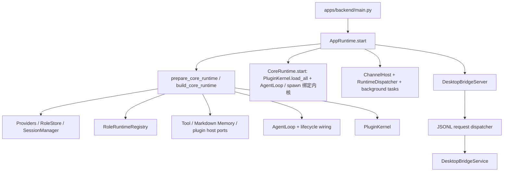
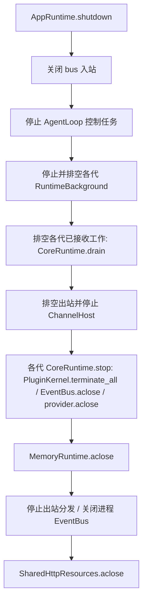

# 当前后端架构基线

本文记录 Python backend 的实际运行边界。Shiori 保留 Python 后端，插件内核自行实现（`packages/sdk/python/shiori_sdk/kernel/`），宿主装配在 `apps/backend/agent/plugin_host/`，不引入外部插件框架。

## 进程与装配

`apps/backend/main.py` 的 `serve_bridge()` 先恢复未完成的配置事务（`ConfigTransaction.recover()`）并应用待处理的插件包安装/卸载操作，再构建 `AppRuntime`。`apps/backend/bootstrap/app.py` 的 `AppRuntime.start()` 经 `bootstrap/runtime/construction.py:prepare_core_runtime()` 调用 `apps/backend/bootstrap/tools.py:build_core_runtime()` 装配一代 `CoreRuntime`（构建失败时回收已分配资源）。CoreRuntime 持有 AgentLoop、MessageBus、EventBus、ToolRegistry、SessionManager、调度与主动回合的宿主端口、LLMProvider、MemoryRuntime、presence（`SessionManager.presence`，即 `session/presence.py` 的 `SessionPresence`）、RoleRuntimeRegistry、GroupEnvironment、群聊旁听开关和 PluginKernel。好感、场景观察和 MCP 登记由插件提供；stdio MCP 客户端在 `infra/process/mcp_client.py`。



事实依据：`apps/backend/main.py` 的 `serve_bridge()`、`apps/backend/bootstrap/app.py` 的 `AppRuntime.start()`、`apps/backend/bootstrap/tools.py` 的 `CoreRuntime` 与 `build_core_runtime()`。

## 插件宿主模块

`agent/plugin_host/kernel.py` 保存每代候选、实例、首次信任激活错误和转换锁，装配公开生命周期方法。`settings.py` 管理代际配置与启用判定，`record.py` 保存候选及其定位规则；`admission.py` 负责信任、内容预检和本轮可激活集合；`plugin_setup.py` 组装 spec、可信导入、配置 schema、上下文与插件导出；`closures.py` 选择启停/重载闭包并执行 D14 拒绝和逐成员排空；`renderer_gate.py` 核对激活 token、渲染就绪与失败。`reload.py` 继续负责配置与实例替换事务，`state.py` 继续从内核状态和准入派生展示状态。辅助模块读取或修改显式传入的现有 owner 引用，不保存另一份生命周期状态。

通信注册、服务 binder 与 renderer 请求生命周期归 `desktop_bridge/plugin_rpc/`；宿主仅持有撤销通信的窄协议。具体边界与规模见 [P8b 决策](../../decisions/2026-11-04-kernel-primitives-host-single-state.md)。

## 运行时换代

`AppRuntime` 不在设置变更时重启进程。`apps/backend/bootstrap/runtime/` 中：

- `GenerationManager` / `RuntimeCandidate` 管理按引用计数的多代 `CoreRuntime`；`RuntimeLease` 把一个任务固定在开始时选中的那一代。
- `RuntimeReloadMixin.prepare()` / `publish()` 由设置事务边界（`desktop_bridge/runtime/apply.py`）调用：先构建新一代，再切换发布指针，旧代在已接收工作排空后关闭（`CoreRuntime.stop()` + `MemoryRuntime.aclose()`）。
- `RuntimeDispatcher` 是 bus 的唯一消费者，为每条渠道消息获取租约后交给当代 `AgentLoop.process_inbound()`；定时任务与子回合沿用父操作的那一代。
- `RuntimeBackground` 在代发布时通知 `SCENE_HOST`，不再构造主动循环。`schedule`、`proactive` 与 `memory_optimizer` 分别拥有跨代进程资源，并在发布后重绑可用端口；宿主提供租约与角色执行边界。插件停用关闭其资源，普通代替换按各资源的保留规则交接。
- `ChannelHost`（`bootstrap/channel_host.py`）是跨代长驻的渠道宿主，负责渠道启动、交接与失败快照。
- 例外：`plugin.config.set` 只改一张插件表时不换代（#857）。`RuntimeSettingsApplication._reload_plugin` 调 `PluginKernel.reload` 在当前代内重载目标及其强依赖和活动可选消费者（排空它们自己的在途调用，含正在执行的 `on` / `watch` 事件处理器，最长 60 秒），落盘在内核不可取消的替换步骤里完成，桥接发 `plugins.reloaded`。闭包含渠道或不支持热卸载的插件、目标非 ACTIVE 时仍走整代切换；已停用插件只落盘。
- 例外：`plugins.setEnabled` 同样不换代（#858）。`_reload_plugin` 改调 `PluginKernel.set_enabled`：停用直接处置目标及其活动的强依赖消费者（不排空，在途工作随之取消，进程资源关闭），按启用标记与内核状态派生 DISABLED / BLOCKED；启用加载 DISABLED 的目标和因它而 BLOCKED 的消费者，setup 失败照整代切换的做法保留为 FAILED。启停都带上活动的可选消费者（`optional_inject` / `optional_dependencies`，#949）：先排空，再随切换重新 setup（`was_active` 为真），失败同样保留为 FAILED。落盘失败恢复原状态，桥接同样发 `plugins.reloaded`。闭包含渠道或不支持热卸载的插件、启用目标的依赖处于 FAILED 等只能整代重试的状态时仍走整代切换。

## Bridge 与消息入口

Electron main 通过 `apps/desktop/src/bridge/bridgeClient.ts` 启动 Python bridge，使用 stdin/stdout JSONL。`apps/backend/desktop_bridge/server.py` 负责解析请求、并发分发、串行写回 response/event，并在退出时关闭 dispatcher、service 和 writer。

桌面聊天的实际路径是 `DesktopBridgeService -> DesktopChatService -> AgentLoop.process_direct`，不经过 `MessageBus`。渠道输入经过 bus，由 `RuntimeDispatcher` 交给 `AgentLoop.process_inbound()`。两条路径最终都进入 `RoleRuntimeRegistry.dispatch_passive_turn()` 的 role-scoped processing。

## RoleRuntime 与唯一角色会话

`RoleRuntimeRegistry` 按 `role_id` 缓存一个稳定 `RoleRuntime`。`RoleRuntime` 以角色为并发边界，使用一把 role-wide turn lock（`RoleExecutionState.turn_lock`，跨运行时代共享）串行化 passive turn、proactive tick、background task 和 role state 操作；每次操作释放锁后发布一次 `ContextWindowChanged`。`RoleExecutionContext` 校验 role、config version、thread、transport、source 和 work kind。

角色会话 key 为 `role:{role_id}`。角色与唯一活跃会话是同一生命周期边界，不存在独立的 Session Plugin 产品概念。角色删除先删除角色记录，再删除 role session，最后通知 role-deleted 监听器级联清理角色记忆和其他 role-owned 状态；监听器未注册时直接报错。角色创建成功后通知 role-created 监听器，桌面桥接发出 `RoleCreated`；没有监听器也能创建。

事实依据：`apps/backend/core/roles/role_runtime.py` 的 `RoleRuntime.execute_thread()` 与 `RoleRuntimeRegistry`、`apps/backend/session/manager/role_sessions.py`、`apps/backend/core/roles/services.py` 的 `RoleAggregateService.delete_role()`。

## 被动回合

```mermaid
flowchart TD
  A[DesktopBridge request] --> B[DesktopChatService]
  B --> C[AgentLoop.process_direct]
  A2[Channel inbound via bus] --> C2[RuntimeDispatcher -> AgentLoop.process_inbound]
  C --> D[role:{id} Session + RoleExecutionContext]
  C2 --> D
  D --> E[RoleRuntimeRegistry.dispatch_passive_turn]
  E --> F[PassiveTurnPipeline]
  F --> G[BeforeTurn]
  G --> H[BeforeReasoning]
  H --> I[Reasoner: prompt / budget / retry / tool loop]
  I --> J[ToolRegistry / Executor / hooks]
  J --> I
  I --> K[AfterReasoning: parse / persist / outbound]
  K --> L[AfterTurn / TurnCommitted]
  L --> M[Session and bridge events]
```

`apps/backend/agent/core/passive_turn/pipeline.py` 的 `PassiveTurnPipeline` 定义 phase 顺序：BeforeTurn、BeforeReasoning、Reasoner（内部执行 BeforeStep/AfterStep 与 PromptRender 模块）、AfterReasoning、AfterTurn。请求超出 `model_context_window` 推导的输入预算时，由 `passive_turn/budgeted_request.py`、`passive_turn/compaction.py` 与 `apps/backend/core/compaction.py` 的 `CompactionController` 处理压缩。Provider 或 reasoner 错误进入用户可见 fallback；AfterReasoning 和 AfterTurn 的权威持久化错误继续向边界冒泡。桌面流事件由 `apps/backend/desktop_bridge/chat_service.py` 发出，包括 `chat.delta`、`chat.tool.started`、`chat.tool.completed`、`chat.done`、`chat.error` 和 `chat.cancelled`；bridge 连接仍在时，每个已受理的回合恰好以后三者之一结束（按 turn_id 取消或 bridge 关闭时发 `chat.cancelled`；按 turn_id 取消会先持久化中断回复并发 `session.updated`）。终止事件的发送受保护，关闭期间的取消不会截断或重复它。

LLM 调用由 `apps/backend/agent/provider.py` 封装，使用官方 `openai` SDK 的 Chat Completions 兼容接口，负责各厂商安全错误、上下文超长错误识别、重试与 usage 记录。

## 主动回合与后台任务

系统插件 `plugins/proactive` 根据时间、presence、关系和观察结果生成 tick。循环是进程资源：本代发布后才按角色启动，之后只重绑已发布代的端口。tick 经 `PROACTIVE_HOST.run_tick` 进入（已持有的代租约保持不变，否则钉住当前发布代），再由 `RoleRuntimeRegistry.dispatch_proactive_tick()` 进入同一角色 runtime，并在角色桌面线程 `role:<id>` 下执行。同一端口还承担这次 tick 的自然回复作用域与工具事实、补全、工具与宿主工具、文件工具、抓取、MCP 会话、目标选择、会话历史和投递。心情目录和已存心情时间在 tick 开始时从本代 `CONVERSATION.reply_state` 读取；哪些角色开启主动、每个角色的主动配置读 `ROLES.plugin_settings(role_id, "proactive")`。场景追问经 `SCENE.request` 登记。后台任务和 drift 使用同一套 role/session/tool 基础设施；定时任务经 `RuntimeDispatcher.run_role_operation()` 固定在所属运行时代。

## 工具、Memory 与插件

- `ToolRegistry` 保存工具、schema、风险、always-on、搜索索引和 source metadata；MCP 工具也同步到该 registry。内置 toolset 由 `apps/backend/bootstrap/toolsets/` 注册。
- 记忆契约 `MemoryEngine`、`MemoryQuery`、`MemoryQueryResult`、`MemoryMutation` 定义在 SDK 的 `packages/sdk/python/shiori_sdk/memory/`；插座是 `MEMORY_ENGINE`。`default_memory` 在 setup 里构造并 `provide`。`MemoryRuntime` 的 getter 读这一代的插座，可以是 None：没有语义检索时对话仍继续，Markdown 记忆照常。
- `PluginKernel` 同时负责 discover/import/config/context 注入、EventBus handler、tool、channel、RPC、服务注册、initialize rollback、drain 和 terminate；插件的回合与工具事件处理器挂在本代内核（`shiori_sdk.kernel`）上。
- 回合与工具事件经本代内核发出：`CoreRuntime.start()` 把读取本代内核的来源绑定给 `AgentLoop.bind_kernel()` 与 spawn 的 `SubagentManager.bind_kernel()`，主动插件通过本代 `PROACTIVE_HOST` 进入角色执行边界。被动回合各阶段（`agent/core/turn_events.py` 的 `TurnEvents`）与 `ToolExecutor` 每次发出事件时读取内核，内核只运行当前 ACTIVE 插件的处理器，插件在代内卸载或新加载后下一次回合/工具调用/主动 tick 即生效。阶段本身只由核心模块组成，构造一次。
- typed `on` / `watch` 由 SDK Kernel 的 Scope 管理；宿主事件 binder 同样把订阅登记到该 Scope。卸载与 setup 失败回滚先撤销订阅，再取消任务，最后按 LIFO 释放 effect；排空与不可卸载判断由宿主在替换前执行。

## 持久化边界

- 角色配置、绑定和素材：`apps/backend/core/roles/` 与 RoleStore facade。
- Session metadata/messages：`apps/backend/session/` 的 SQLite store；消息可能含 `tool_chain`、reasoning 和 proactive metadata。
- Conversation：`apps/backend/conversation/` 负责 legacy session key 到正式 thread 的映射，以及群聊旁听数据。
- 角色记忆：`workspace/roles/{role_id}/memory` 及具体 MemoryStore/索引。
- 插件配置在主 TOML 的 `[plugins.<id>]`；KV 与私有持久化文件位于 `workspace/plugin-data/<id>/`；外部安装的插件包位于 `workspace/plugins/`。

## 关闭流程

`AppRuntime.shutdown()`（`bootstrap/runtime/shutdown.py`）按以下顺序执行，单步失败不阻止后续步骤，错误最终聚合抛出：



## 待验证项

- Proactive、scheduler 和所有 background task 是否都严格共享同一 RoleRuntime lock。
- DesktopBridge 每个 RPC method 到 request handler 的完整映射。
- 插件热换代的跨渠道竞态需结合各 owning module 的生命周期测试与运行 trace 验证。
- 渠道 bus 路径与 DesktopBridge direct path 在所有渠道上的行为差异。
